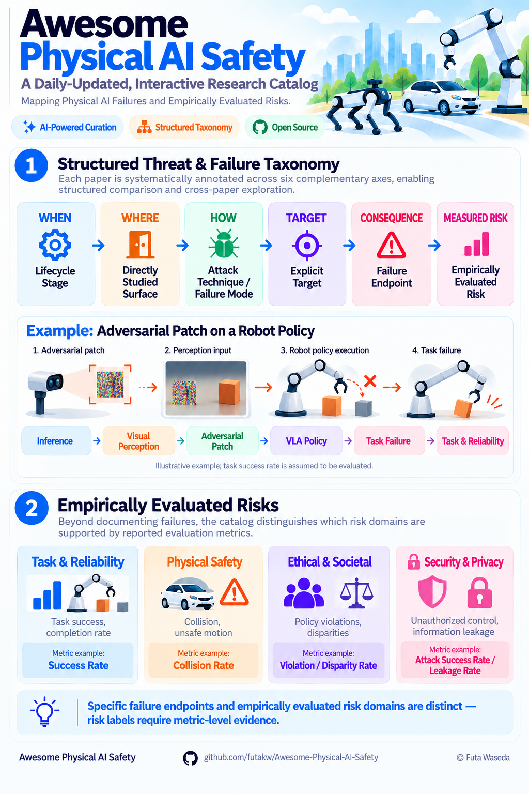
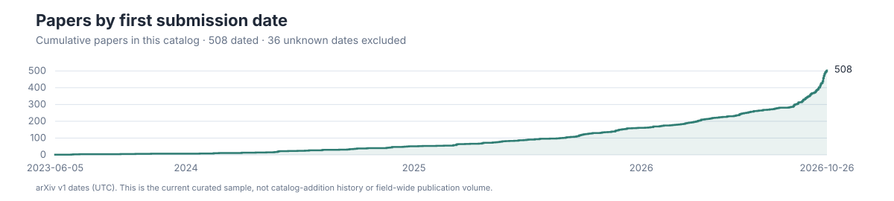

# Awesome Physical AI Safety

**English (this page)** | [Japanese](README.ja.md)

**🤖 An LLM-assisted bibliography of physical AI and embodied AI safety, spanning security, robustness, ethical and societal risks, and trustworthy deployment for VLA models, robots, and autonomous systems.**

[](https://awesome.re)
[](CONTRIBUTING.md)
[](CITATION.cff)
[](https://doi.org/10.5281/zenodo.23348593)
[](docs/agent/daily-curation-workflow.md)
[](LICENSES.md) [](https://futakw.github.io/Awesome-Physical-AI-Safety/) [](docs/agent/daily-curation-workflow.md)

**[🔎 Explore the interactive research landscape →](https://futakw.github.io/Awesome-Physical-AI-Safety/)** — start with the catalog overview, then explore charts and their contributing papers.

⭐ **If this catalog is useful to you, please star the repo** — it helps other researchers find it and signals that a maintained taxonomy for this field is worth keeping alive.

## Author

[**Futa Waseda**](https://futa-waseda.netlify.app/) — Project Assistant Professor, National Institute of Informatics (NII), Japan.

## About This Catalog

This LLM-assisted catalog helps researchers explore **how physical AI systems fail** and **which risk outcomes are evaluated** across VLAs, robots, autonomous systems, and embodied agents.

<p align="center">
  <a href="assets/visualizations/physical-ai-safety-overview.png">
    
  </a>
</p>

The five-part threat taxonomy describes studied failure paths; **Measured Risk** labels are classified separately using the metrics reported in each paper. See the [taxonomy and labeling criteria](docs/reference/taxonomy.md) for details.

### Scope

This catalog focuses on the safety and trustworthiness of **foundation model–based Physical AI**, viewed through **Perception → Cognition → Planning → Action**. This is a conceptual pipeline, not a required modular architecture, and includes VLA models and LLM/VLM-driven embodied systems in human–robot interaction, multi-robot collaboration, and autonomous driving. General-purpose LLM/VLM work without a clear physical-AI connection is out of scope.

### Curation Policy

Taxonomy and workflow design are author-maintained, while paper collection and classification are updated through an LLM-assisted process without individual human review before each update. Metadata may contain errors; please verify important details against the original papers. [Corrections and contributions](CONTRIBUTING.md) are welcome.

Each paper has one catalog record and one primary-contribution section. Cross-cutting tables are generated views of those same records, not separate entries.

The optional Defense, Evaluation, and Benchmark metadata extensions are documented in [docs/reference/metadata-schema.md](docs/reference/metadata-schema.md).

## 📚 Citing

Cite this catalog for its bibliography, taxonomy, metadata, visualizations, or curation methodology; cite original papers for individual claims. See [CITATION.cff](CITATION.cff).

```bibtex
@software{Waseda_Awesome_Physical_AI_2026,
  author = {Waseda, Futa},
  doi    = {10.5281/zenodo.23348593},
  month  = oct,
  title  = {{Awesome Physical AI Safety}},
  url    = {https://github.com/futakw/Awesome-Physical-AI-Safety},
  year   = {2026}
}
```

## 🔎 Research Landscape

These metadata-based views reveal relationships within this catalog—not field-wide prevalence or evidence that a defense works. Open a cell to check its source papers.



Cumulative papers by initial submission date (arXiv v1, UTC); unknown dates are excluded. This describes the current catalog sample.

[](https://futakw.github.io/Awesome-Physical-AI-Safety/#timeline)

Where has this catalog grown over time? [Explore the timeline →](https://futakw.github.io/Awesome-Physical-AI-Safety/#timeline)

[](https://futakw.github.io/Awesome-Physical-AI-Safety/#heatmap)

Which threat mechanisms appear at which entry surfaces? [Explore the cross-map →](https://futakw.github.io/Awesome-Physical-AI-Safety/#heatmap)

[](https://futakw.github.io/Awesome-Physical-AI-Safety/#risk)

Which measured outcomes are reported for each mechanism? [Inspect the underlying papers →](https://futakw.github.io/Awesome-Physical-AI-Safety/#risk)

## How to Read the Catalog

Each paper is organized by its primary contribution, with two complementary metadata columns:

### Measured Risk

Risk labels summarize the outcomes evaluated in each paper:

- : Task or route success.
- : Collisions, damage, or unsafe motion.
- : Harmful compliance, policy violations, or disparities.
- : Attack success, hijacking, or information leakage.

**—** indicates that no corresponding risk outcome is identified from the reported metrics.

### Threat Model

Each entry summarizes the structured threat and failure taxonomy in two lines:

 · <br> &nbsp;→&nbsp;  &nbsp;→&nbsp; 

A `+N` suffix indicates additional values stored in `data/papers.json`.

For detailed definitions and classification criteria, see the [full taxonomy](docs/reference/taxonomy.md).

## 🧭 Contents

- [📚 Surveys and Perspectives](#surveys)
- [🌍 Robustness and OOD Generalization](#ood-generalization)
- [🧪 Training-Time Attacks](#training-attacks)
- [⚡ Inference-Time Attacks](#inference-attacks)
- [🛡️ Defenses and Safety Mechanisms](#defenses)
- [📊 Benchmarks and Evaluation](#benchmarks)
- [🔐 System-Level Security, Privacy, and Misuse](#system-security)
- [⚖️ Ethics & Societal Safety](#ethics-societal-safety)

<details>
<summary><strong>Show subsection index</strong></summary>

- **📚 Surveys and Perspectives**
  - [Embodied AI Safety and Security](#surveys-embodied-ai-safety-and-security)
  - [Domain-Specific Surveys](#surveys-domain-specific-surveys)
  - [Position Papers and Research Agendas](#surveys-position-papers-and-research-agendas)
  - [General VLA Surveys](#surveys-general-vla-surveys)
  - [Training and Adaptation Surveys](#surveys-training-and-adaptation-surveys)
  - [World Model Safety and Security](#surveys-world-model-safety-and-security)
  - [Privacy, Fairness, and Human-Robot Trust](#surveys-privacy-fairness-and-human-robot-trust)
  - [Governance and Deployment Assurance](#surveys-governance-and-deployment-assurance)
- **🌍 Robustness and OOD Generalization**
  - [OOD and Generalization](#ood-generalization-ood-and-generalization)
  - [Representation and Language-Action Generalization](#ood-generalization-representation-and-language-action-generalization)
  - [Action and Spatial Generalization](#ood-generalization-action-and-spatial-generalization)
  - [Language and Instruction Generalization](#ood-generalization-language-and-instruction-generalization)
  - [Open-World Evaluation](#ood-generalization-open-world-evaluation)
  - [Driving Robustness and Generalization](#ood-generalization-driving-robustness-and-generalization)
  - [Reliability-Oriented Policy Refinement](#ood-generalization-reliability-oriented-policy-refinement)
- **🧪 Training-Time Attacks**
  - [Backdoors and Data Poisoning](#training-attacks-backdoors-and-data-poisoning)
  - [Privacy and Data Leakage](#training-attacks-privacy-and-data-leakage)
- **⚡ Inference-Time Attacks**
  - [Planning, Action, and Trajectory Manipulation](#inference-attacks-planning-action-and-trajectory-manipulation)
  - [Jailbreaks and Prompt Injection](#inference-attacks-jailbreaks-and-prompt-injection)
  - [Visual Perturbations and Patches](#inference-attacks-visual-perturbations-and-patches)
  - [Privacy and Data Leakage](#inference-attacks-privacy-and-data-leakage)
  - [Sensor, State, and Physical Interventions](#inference-attacks-sensor-state-and-physical-interventions)
  - [Upstream VLM Attacks](#inference-attacks-upstream-vlm-attacks)
- **🛡️ Defenses and Safety Mechanisms**
  - [Safety-Aligned and Robust Policy Training](#defenses-safety-aligned-and-robust-policy-training)
  - [Runtime Monitoring and Guardrails](#defenses-runtime-monitoring-and-guardrails)
  - [Failure Detection, Shielding, and Recovery](#defenses-failure-detection-shielding-and-recovery)
  - [Representation Steering and Inference-Time Defense](#defenses-representation-steering-and-inference-time-defense)
  - [System and Communication Defenses](#defenses-system-and-communication-defenses)
  - [Multimodal Perception and Physical Safeguards](#defenses-multimodal-perception-and-physical-safeguards)
  - [Uncertainty, Abstention, and Human Oversight](#defenses-uncertainty-abstention-and-human-oversight)
  - [Model Unlearning and Data Governance](#defenses-model-unlearning-and-data-governance)
  - [Privacy-Preserving Perception](#defenses-privacy-preserving-perception)
  - [Safety Requirements and Assurance](#defenses-safety-requirements-and-assurance)
- **📊 Benchmarks and Evaluation**
  - [Robustness, Uncertainty, and OOD Generalization](#benchmarks-robustness-uncertainty-and-ood-generalization)
  - [Evaluation Infrastructure](#benchmarks-evaluation-infrastructure)
  - [Adversarial and Physical Robustness](#benchmarks-adversarial-and-physical-robustness)
  - [Task and Physical Safety](#benchmarks-task-and-physical-safety)
  - [Semantic and Ethical Safety](#benchmarks-semantic-and-ethical-safety)
  - [Safety-Critical Perception Evaluation](#benchmarks-safety-critical-perception-evaluation)
  - [Privacy and Data Leakage](#benchmarks-privacy-and-data-leakage)
  - [Governance and Deployment Assurance](#benchmarks-governance-and-deployment-assurance)
  - [Human-Robot Trust and Fairness](#benchmarks-human-robot-trust-and-fairness)
  - [Failure Detection and Recovery](#benchmarks-failure-detection-and-recovery)
- **🔐 System-Level Security, Privacy, and Misuse**
  - [Cross-Layer System Security](#system-security-cross-layer-system-security)
  - [Privacy, Misuse, and Covert Channels](#system-security-privacy-misuse-and-covert-channels)

</details>

**440 papers in the current catalog.**

<a id="surveys"></a>

## 📚 Surveys and Perspectives

<a id="surveys-embodied-ai-safety-and-security"></a>

### Embodied AI Safety and Security

| Paper | Venue | Measured Risk | Threat Model |
|---|---:|---|---|
| **[From bits to atoms: A survey of cross-layer safety in Embodied AI](https://arxiv.org/abs/2610.14038)**<br><sub>Feng et al.</sub> | AI Plus 2026 | — |   <br>  |
| **[Navigating Embodied Intelligence: Enabling Technologies, Security and Privacy, and Emerging Trends](https://doi.org/10.1109/JIOT.2025.3649049)**<br><sub>Wang et al.</sub> | IEEE IoT Journal 2026 | — |   <br>  |
| **[Safe Embodied AI for Long-horizon Tasks: A Cross-layer Analysis of Robotic Manipulation](https://arxiv.org/abs/2606.05660)**<br><sub>Kim et al.</sub> | arXiv 2026 | — |   <br>  |
| **[Safety in Embodied AI: A Survey of Risks, Attacks, and Defenses](https://arxiv.org/abs/2605.02900)**<br><sub>Li et al.</sub> | arXiv 2026 | — |   <br>  |
| **[Security of World-Model-Based Embodied AI: A Lifecycle of Threats, Defenses, and Evaluation](https://arxiv.org/abs/2607.28226)**<br><sub>Liu et al.</sub> | arXiv 2026 | — |   <br>  |
| **[SoK: Security and Privacy of Foundation-Model-Powered Robots](https://arxiv.org/abs/2606.16788)**<br><sub>Gong et al.</sub> | arXiv 2026 |  |   <br>  |
| **[Toward Secure LLM Agents: Threat Surfaces, Attacks, Defenses, and Evaluation](https://arxiv.org/abs/2606.10749)**<br><sub>Ling et al.</sub> | arXiv 2026 | — |   <br>  |
| **[Vision-Language-Action Safety: Threats, Challenges, Evaluations, and Mechanisms](https://arxiv.org/abs/2604.23775)** [](https://github.com/LiQiiiii/Awesome-VLA-Safety)<br><sub>Li et al.</sub> | arXiv 2026 | — |   <br>  |
| **[What Breaks Embodied AI Security:LLM Vulnerabilities, CPS Flaws,or Something Else?](https://arxiv.org/abs/2602.17345)**<br><sub>Ma et al.</sub> | arXiv 2026 | — |   <br>  |
| **[A Comprehensive Survey on Physical Risk Control in the Era of Foundation Model-enabled Robotics](https://arxiv.org/abs/2505.12583)**<br><sub>Kojima et al.</sub> | arXiv 2025 | — |   <br>  |
| **[Safe Learning for Contact-Rich Robot Tasks: A Survey from Classical Learning-Based Methods to Safe Foundation Models](https://arxiv.org/abs/2512.11908)** [](https://github.com/jack-sherman01/Awesome-Learning4Safe-Contact-rich-tasks)<br><sub>Zhang et al.</sub> | arXiv 2025 | — |   <br>  |
| **[Safety of Embodied Navigation: A Survey](https://arxiv.org/abs/2508.05855)**<br><sub>Wang et al.</sub> | arXiv 2025 | — |   <br>  |
| **[SoK: Cybersecurity Assessment of Humanoid Ecosystem](https://arxiv.org/abs/2508.17481)**<br><sub>Surve et al.</sub> | arXiv 2025 |  |   <br>  |
| **[Towards Robust and Secure Embodied AI: A Survey on Vulnerabilities and Attacks](https://arxiv.org/abs/2502.13175)**<br><sub>Xing et al.</sub> | arXiv 2025 | — |   <br>  |
| **[Towards Safe and Trustworthy Embodied AI: Foundations, Status, and Prospects](https://openreview.net/forum?id=Eu6Yt21Alv)** [](https://github.com/AI45Lab/Awesome-Trustworthy-Embodied-AI)<br><sub>Tan et al.</sub> | OpenReview 2025 | — |   <br>  |
| **[Trust in LLM-controlled Robotics: a Survey of Security Threats, Defenses and Challenges](https://arxiv.org/abs/2601.02377)**<br><sub>Huang et al.</sub> | arXiv 2025 | — |   <br>  |
| **[Security Considerations in AI-Robotics: A Survey of Current Methods, Challenges, and Opportunities](https://arxiv.org/abs/2310.08565)**<br><sub>Neupane et al.</sub> | arXiv 2023 | — |   <br>  |

<a id="surveys-domain-specific-surveys"></a>

### Domain-Specific Surveys

| Paper | Venue | Measured Risk | Threat Model |
|---|---:|---|---|
| **[Foundation Models for Autonomous Space Robotics: Architectures, Physical Adaptation, and Validation](https://arxiv.org/abs/2610.23068)**<br><sub>Wang et al.</sub> | arXiv 2026 | — |   <br>  |
| **[A Survey on Vision-Language-Action Models for Autonomous Driving](https://arxiv.org/abs/2506.24044)** [](https://github.com/JohnsonJiang1996/Awesome-VLA4AD)<br><sub>Jiang et al.</sub> | arXiv 2025 | — |   <br>  |
| **[From screens to scenes: A survey of embodied AI in healthcare](https://doi.org/10.1016/j.inffus.2025.103033)**<br><sub>Liu et al.</sub> | Information Fusion 2025 | — |   <br>  |
| **[Vision-Language-Action Models for Robotics: A Review Towards Real-World Applications](https://arxiv.org/abs/2510.07077)** [Project / Code](https://vla-survey.github.io/)<br><sub>Kawaharazuka et al.</sub> | IEEE Access 2025 | — |   <br>  |

<a id="surveys-position-papers-and-research-agendas"></a>

### Position Papers and Research Agendas

| Paper | Venue | Measured Risk | Threat Model |
|---|---:|---|---|
| **[ARC: Autonomous Robotics Compliance A Three-Layer Governance Architecture for Deployed Autonomous Systems](https://arxiv.org/abs/2609.12932)**<br><sub>Eide et al.</sub> | arXiv 2026 | — |   <br>  |
| **[Building Trustworthy Household Robots through Open-World Safety](https://arxiv.org/abs/2610.14034)**<br><sub>Tsai et al.</sub> | arXiv 2026 | — |   <br>  |
| **[Rethinking Safety for Generalist Robots](https://arxiv.org/abs/2609.06326)**<br><sub>Sinha et al.</sub> | arXiv 2026 | — |   <br>  |
| **[Rethinking World Models for Safety-Critical Embodied Systems](https://arxiv.org/abs/2609.03774)**<br><sub>Ma et al.</sub> | arXiv 2026 | — |   <br>  |
| **[Toward Study on the Effects of Robot's Humorous Apology on Human's Trust Recovery](https://arxiv.org/abs/2610.16334)**<br><sub>Kim et al.</sub> | arXiv 2026 | — |   <br>  |
| **[Embodied AI: Emerging Risks and Opportunities for Policy Action](https://arxiv.org/abs/2509.00117)**<br><sub>Perlo et al.</sub> | arXiv 2025 | — |   <br>  |
| **[Position: Human-Robot Interaction in Embodied Intelligence Demands a Shift From Static Privacy Controls to Dynamic Learning](https://arxiv.org/abs/2509.19041)**<br><sub>Zhang et al.</sub> | NeurIPS Workshop 2025 | — |   <br>  |

<a id="surveys-general-vla-surveys"></a>

### General VLA Surveys

| Paper | Venue | Measured Risk | Threat Model |
|---|---:|---|---|
| **[Large VLM-based Vision-Language-Action Models for Robotic Manipulation: A Survey](https://arxiv.org/abs/2508.13073)** [](https://github.com/JiuTian-VL/Large-VLM-based-VLA-for-Robotic-Manipulation)<br><sub>Shao et al.</sub> | arXiv 2025 | — |   <br>  |
| **[Pure Vision Language Action (VLA) Models: A Comprehensive Survey](https://arxiv.org/abs/2509.19012)**<br><sub>Zhang et al.</sub> | arXiv 2025 | — |   <br>  |
| **[Vision Language Action Models in Robotic Manipulation: A Systematic Review](https://arxiv.org/abs/2507.10672)** [](https://github.com/Muhayyuddin/VLAs)<br><sub>Din et al.</sub> | arXiv 2025 | — |   <br>  |
| **[Vision-Language-Action (VLA) Models: Concepts, Progress, Applications and Challenges](https://arxiv.org/abs/2505.04769)** [](https://github.com/Applied-AI-Research-Lab/Vision-Language-Action-Models-Concepts-Progress-Applications-and-Challenges)<br><sub>Sapkota et al.</sub> | arXiv 2025 | — |   <br>  |
| **[A Survey on Vision-Language-Action Models for Embodied AI](https://arxiv.org/abs/2405.14093)** [](https://github.com/yueen-ma/Awesome-VLA)<br><sub>Ma et al.</sub> | arXiv 2024 | — |   <br>  |

<a id="surveys-training-and-adaptation-surveys"></a>

### Training and Adaptation Surveys

| Paper | Venue | Measured Risk | Threat Model |
|---|---:|---|---|
| **[A Survey on Efficient Vision-Language-Action Models](https://arxiv.org/abs/2510.24795)** [Project / Code](https://evla-survey.github.io/)<br><sub>Yu et al.</sub> | arXiv 2025 | — |   <br>  |
| **[A Survey on Vision-Language-Action Models: An Action Tokenization Perspective](https://arxiv.org/abs/2507.01925)**<br><sub>Zhong et al.</sub> | arXiv 2025 | — |   <br>  |
| **[Parallels Between VLA Model Post-Training and Human Motor Learning: Progress, Challenges, and Trends](https://arxiv.org/abs/2506.20966)** [](https://github.com/AoqunJin/Awesome-VLA-Post-Training)<br><sub>Xiang et al.</sub> | arXiv 2025 | — |   <br>  |

<a id="surveys-world-model-safety-and-security"></a>

### World Model Safety and Security

| Paper | Venue | Measured Risk | Threat Model |
|---|---:|---|---|
| **[Safety, Security, and Cognitive Risks in World Models](https://arxiv.org/abs/2604.01346)**<br><sub>Parmar et al.</sub> | arXiv 2026 | — |   <br>  |
| **[The Safety Challenge of World Models for Embodied AI Agents: A Review](https://arxiv.org/abs/2510.05865)**<br><sub>Baraldi et al.</sub> | arXiv 2025 |  |   <br>  |

<a id="surveys-privacy-fairness-and-human-robot-trust"></a>

### Privacy, Fairness, and Human-Robot Trust

| Paper | Venue | Measured Risk | Threat Model |
|---|---:|---|---|
| **[Designing Social Robots with Ethical, User-Adaptive Explainability in the Era of Foundation Models](https://doi.org/10.1145/3776734.3794453)**<br><sub>Doğan et al.</sub> | HRI Companion 2026 | — |   <br>  |
| **[Position: Embodied AI Requires a Privacy-Utility Trade-off](https://arxiv.org/abs/2605.05017)** [](https://github.com/rminshen03/EAI_Privacy_Position)<br><sub>Fan et al.</sub> | arXiv 2026 | — |   <br>  |
| **[Privacy beyond Data: Assessment and Mitigation of Privacy Risks in Robotic Technology for Elderly Care](https://doi.org/10.1145/3689216)**<br><sub>Grabler et al.</sub> | ACM Transactions on Human-Robot Interaction 2025 | — |   <br>  |
| **[Who’s in Charge Here? A Survey on Trustworthy AI in Variable Autonomy Robotic Systems](https://doi.org/10.1145/3645090)**<br><sub>Methnani et al.</sub> | ACM Computing Surveys 2024 | — |   <br>  |
| **[The Challenges and Opportunities of Human-Centered AI for Trustworthy Robots and Autonomous Systems](https://doi.org/10.1109/tcds.2021.3132282)**<br><sub>He et al.</sub> | IEEE Transactions on Cognitive and Developmental Systems 2022 | — |   <br>  |
| **[Explainable Embodied Agents Through Social Cues](https://doi.org/10.1145/3457188)**<br><sub>Wallkötter et al.</sub> | ACM Transactions on Human-Robot Interaction 2021 | — |   <br>  |

<a id="surveys-governance-and-deployment-assurance"></a>

### Governance and Deployment Assurance

| Paper | Venue | Measured Risk | Threat Model |
|---|---:|---|---|
| **[Safety Case Patterns for VLA-based driving systems: Insights from SimLingo](https://arxiv.org/abs/2603.16013)**<br><sub>Yu et al.</sub> | arXiv 2026 | — |   <br>  |
| **[EHAZOP: A Proof of Concept Ethical Hazard Analysis of an Assistive Robot](https://arxiv.org/abs/2406.09239)**<br><sub>Menon et al.</sub> | arXiv 2024 | — |   <br>  |

<a id="ood-generalization"></a>

## 🌍 Robustness and OOD Generalization

<a id="ood-generalization-ood-and-generalization"></a>

### OOD and Generalization

| Paper | Venue | Measured Risk | Threat Model |
|---|---:|---|---|
| **[Are Vision-Language-Action Models Robust to One-Step Observation Perturbations?](https://arxiv.org/abs/2609.32550)**<br><sub>Yamabe et al.</sub> | arXiv 2026 |  |   <br>  &nbsp;→&nbsp;  &nbsp;→&nbsp;  |
| **[AWAM: Active Trajectory-Conditioned View Imagination for Robust Robot Manipulation](https://arxiv.org/abs/2610.23396)**<br><sub>Geng et al.</sub> | arXiv 2026 |  |   <br>  &nbsp;→&nbsp;  &nbsp;→&nbsp;  |
| **[Does Adversarial Training Improve Generalization in Multi-View VLAs? Revealing and Mitigating View Collapse](https://arxiv.org/abs/2609.33707)**<br><sub>Waseda et al.</sub> | arXiv 2026 |  |   <br>  &nbsp;→&nbsp;  &nbsp;→&nbsp;  |
| **[FCTS: Failure-Guided Curriculum Tree Search Over Generated Terrain for Legged Parkour](https://arxiv.org/abs/2610.22619)**<br><sub>Parameswaran et al.</sub> | arXiv 2026 |  |   <br>  &nbsp;→&nbsp;  &nbsp;→&nbsp;  |
| **[Human-Human & Human-Robot Interaction Transformer (H2INT) for Robot Navigation in Dense and Uncertain Crowds](https://arxiv.org/abs/2609.05300)**<br><sub>Shen et al.</sub> | arXiv 2026 |   |   <br>  &nbsp;→&nbsp;  &nbsp;→&nbsp;  |
| **[Look Before You Act: Bridging Active Perception and Vision-Language-Action Models via Observation-Aligned Data Adaptation](https://arxiv.org/abs/2610.23378)**<br><sub>Geng et al.</sub> | arXiv 2026 |  |   <br>  &nbsp;→&nbsp;  &nbsp;→&nbsp;  |
| **[Red-Teaming of Vision-Language-Action Models via Quality Diversity Environment Generation](https://arxiv.org/abs/2610.14415)** [Project / Code](https://qd-env.github.io/qdeg/)<br><sub>Zhao et al.</sub> | arXiv 2026 |  |   <br>  &nbsp;→&nbsp;  &nbsp;→&nbsp;  |
| **[Geometric Red-Teaming for Robotic Manipulation](https://arxiv.org/abs/2509.12379)**<br><sub>Goel et al.</sub> | arXiv 2025 |  |   <br>  &nbsp;→&nbsp;  &nbsp;→&nbsp;  |
| **[On the Vulnerability of LLM/VLM-Controlled Robotics](https://arxiv.org/abs/2402.10340)**<br><sub>Wu et al.</sub> | arXiv 2024 |  |   <br>  &nbsp;→&nbsp;  &nbsp;→&nbsp;  |

<a id="ood-generalization-representation-and-language-action-generalization"></a>

### Representation and Language-Action Generalization

| Paper | Venue | Measured Risk | Threat Model |
|---|---:|---|---|
| **[Generalizable VLA Finetuning via Representation Anchoring and Language-Action Alignment](https://arxiv.org/abs/2607.13429)** [](https://github.com/dwipddalal/Anchor-Align)<br><sub>Dalal et al.</sub> | arXiv 2026 |  |   <br>  &nbsp;→&nbsp;  &nbsp;→&nbsp;  |
| **[RARA: Robust Policy Fine-Tuning through Retrieval-Anchored Representation Alignment for Robotic Manipulation](https://arxiv.org/abs/2610.13578)** [Project / Code](https://shua-kang.github.io/RARA_robot/)<br><sub>Kang et al.</sub> | arXiv 2026 |  |   <br>  &nbsp;→&nbsp;  &nbsp;→&nbsp;  |
| **[Don't Blind Your VLA: Aligning Visual Representations for OOD Generalization](https://arxiv.org/abs/2510.25616)** [Project / Code](https://blind-vla-paper.github.io/)<br><sub>Kachaev et al.</sub> | arXiv 2025 |  |   <br>  &nbsp;→&nbsp;  &nbsp;→&nbsp;  |

<a id="ood-generalization-action-and-spatial-generalization"></a>

### Action and Spatial Generalization

| Paper | Venue | Measured Risk | Threat Model |
|---|---:|---|---|
| **[Boosting Vision-Language-Action Finetuning with Feasible Action Neighborhood Prior](https://arxiv.org/abs/2604.01570)** [](https://github.com/Haochen-Niu/FAN-VLA)<br><sub>Niu et al.</sub> | CVPR 2026 |  |   <br>  &nbsp;→&nbsp;  &nbsp;→&nbsp;  |
| **[Embodiment-Classifier Guidance: Transferring Frozen VLAs Across Robot Dynamics without Demonstrations](https://arxiv.org/abs/2610.22576)**<br><sub>Han et al.</sub> | arXiv 2026 |  |   <br>  &nbsp;→&nbsp;  &nbsp;→&nbsp;  |
| **[From Fixed to Free Cameras: Calibration-Free View-Robust Vision-Language-Action Model](https://arxiv.org/abs/2607.05396)** [Project / Code](https://alibaba-damo-academy.github.io/CamVLA/)<br><sub>Li et al.</sub> | arXiv 2026 |  |   <br>  &nbsp;→&nbsp;  &nbsp;→&nbsp;  |

<a id="ood-generalization-language-and-instruction-generalization"></a>

### Language and Instruction Generalization

| Paper | Venue | Measured Risk | Threat Model |
|---|---:|---|---|
| **[Do Vision-Language-Action Models Understand Instructions? A Mechanistic Interpretability Study on Language Grounding](https://arxiv.org/abs/2610.10178)**<br><sub>Wulff et al.</sub> | arXiv 2026 | — |   <br>  &nbsp;→&nbsp;  &nbsp;→&nbsp;  |
| **[ICR-Drive: Instruction Counterfactual Robustness for End-to-End Language-Driven Autonomous Driving](https://arxiv.org/abs/2604.05378)** [](https://github.com/icrdrive/icrdrive)<br><sub>Hamid et al.</sub> | arXiv 2026 |  |   <br>  &nbsp;→&nbsp;  &nbsp;→&nbsp;  |

<a id="ood-generalization-open-world-evaluation"></a>

### Open-World Evaluation

| Paper | Venue | Measured Risk | Threat Model |
|---|---:|---|---|
| **[How VLAs (Really) Work in Open-World Environments](https://arxiv.org/abs/2604.21192)**<br><sub>Rasouli et al.</sub> | arXiv 2026 |   |   <br>  &nbsp;→&nbsp;  &nbsp;→&nbsp;  |
| **[π0.5: a Vision-Language-Action Model with Open-World Generalization](https://arxiv.org/abs/2504.16054)** [](https://github.com/Physical-Intelligence/openpi)<br><sub>Physical Intelligence et al.</sub> | arXiv 2025 |  |   <br>  &nbsp;→&nbsp;  &nbsp;→&nbsp;  |

<a id="ood-generalization-driving-robustness-and-generalization"></a>

### Driving Robustness and Generalization

| Paper | Venue | Measured Risk | Threat Model |
|---|---:|---|---|
| **[Generative Scenario Rollouts for End-to-End Autonomous Driving](https://arxiv.org/abs/2601.11475)**<br><sub>Yasarla et al.</sub> | arXiv 2026 |   |   <br>  &nbsp;→&nbsp;  &nbsp;→&nbsp;  |
| **[Shift & Drift: A Zero-Shot Benchmark for Generalizable and Robust Autonomous Driving Motion Planning](https://arxiv.org/abs/2607.07844)**<br><sub>Canevaro et al.</sub> | IROS 2026 |  |   <br>  &nbsp;→&nbsp;  &nbsp;→&nbsp;  |

<a id="ood-generalization-reliability-oriented-policy-refinement"></a>

### Reliability-Oriented Policy Refinement

| Paper | Venue | Measured Risk | Threat Model |
|---|---:|---|---|
| **[Recovering Low-Bit Failures in Vision-Language-Action Policies via Quantization-Conditioned Reinforcement Learning](https://arxiv.org/abs/2610.15675)**<br><sub>Park et al.</sub> | arXiv 2026 |  |   <br>  &nbsp;→&nbsp;  &nbsp;→&nbsp;  |

<a id="training-attacks"></a>

## 🧪 Training-Time Attacks

<a id="training-attacks-backdoors-and-data-poisoning"></a>

### Backdoors and Data Poisoning

| Paper | Venue | Measured Risk | Threat Model |
|---|---:|---|---|
| **["Your Robot Was Trained on a Lie": Collision Mesh Poisoning Attacks on Robotic Manipulation](https://arxiv.org/abs/2609.18122)**<br><sub>Xu et al.</sub> | arXiv 2026 |    |   <br>  &nbsp;→&nbsp;  &nbsp;→&nbsp;  |
| **[Backdoors in Learning-Based Industrial Robotic Arm Manipulation: An Empirical Security Study](https://arxiv.org/abs/2609.26868)**<br><sub>Zhang et al.</sub> | IROS 2026 Workshop 2026 |   |   <br>  &nbsp;→&nbsp;  &nbsp;→&nbsp;  |
| **[Clean-Action Backdoor Attacks on Vision-Language-Action Models via Sequential Error Exploitation](https://openreview.net/forum?id=QQdn8nNqgi)**<br><sub>Anonymous et al.</sub> | OpenReview 2026 |  |   <br>  &nbsp;→&nbsp;  &nbsp;→&nbsp;  |
| **[FlowHijack: A Dynamics-Aware Backdoor Attack on Flow-Matching Vision-Language-Action Models](https://arxiv.org/abs/2604.09651)**<br><sub>An et al.</sub> | arXiv 2026 |   |   <br>  &nbsp;→&nbsp;  &nbsp;→&nbsp;  |
| **[From Prompt to Physical Action: Structured Backdoor Attacks on LLM-Mediated Robotic Control Systems](https://arxiv.org/abs/2604.03890)**<br><sub>Xie et al.</sub> | arXiv 2026 |  |   <br>  &nbsp;→&nbsp;  &nbsp;→&nbsp;  |
| **[Inject Once Survive Later: Backdooring Vision-Language-Action Models to Persist Through Downstream Fine-tuning](https://arxiv.org/abs/2602.00500)** [Project / Code](https://jianyi2004.github.io/infuse-vla-backdoor/)<br><sub>Zhou et al.</sub> | arXiv 2026 |   |   <br>  &nbsp;→&nbsp;  &nbsp;→&nbsp;  |
| **[SilentDrift: Exploiting Action Chunking for Stealthy Backdoor Attacks on Vision-Language-Action Models](https://arxiv.org/abs/2601.14323)**<br><sub>Xu et al.</sub> | arXiv 2026 |   |   <br>  &nbsp;→&nbsp;  &nbsp;→&nbsp;  |
| **[State Backdoor: Towards Stealthy Real-world Poisoning Attack on Vision-Language-Action Model in State Space](https://arxiv.org/abs/2601.04266)**<br><sub>Guo et al.</sub> | arXiv 2026 |   |   <br>  &nbsp;→&nbsp;  &nbsp;→&nbsp;  |
| **[Targeting World Models to Compromise Robot Learning Pipelines](https://arxiv.org/abs/2606.09499)**<br><sub>Rathbun et al.</sub> | CoRL 2026 |  |   <br>  &nbsp;→&nbsp;  &nbsp;→&nbsp;  |
| **[TRAP: Tail-aware Ranking Attack for World-Model Planning](https://arxiv.org/abs/2605.01950)**<br><sub>Duan et al.</sub> | arXiv 2026 |  |   <br>  &nbsp;→&nbsp;  &nbsp;→&nbsp;  |
| **[TrapVLA: Trapping Vision-Language-Action Models in Configured Failure Modes](https://arxiv.org/abs/2608.26578)** [Project / Code](https://john-liua.github.io/TrapVLA/)<br><sub>Liu et al.</sub> | arXiv 2026 |   |   <br>  &nbsp;→&nbsp;  &nbsp;→&nbsp;  |
| **[BadVLA: Towards Backdoor Attacks on Vision-Language-Action Models via Objective-Decoupled Optimization](https://arxiv.org/abs/2505.16640)** [](https://github.com/Zxy-MLlab/BadVLA)<br><sub>Zhou et al.</sub> | NeurIPS 2025 |   |   <br>  &nbsp;→&nbsp;  &nbsp;→&nbsp;  |
| **[BEAT: Visual Backdoor Attacks on VLM-based Embodied Agents via Contrastive Trigger Learning](https://arxiv.org/abs/2510.27623)**<br><sub>Zhan et al.</sub> | arXiv 2025 |   |   <br>  &nbsp;→&nbsp;  &nbsp;→&nbsp;  |
| **[Can We Trust Embodied Agents? Exploring Backdoor Attacks Against Embodied LLM-Based Decision-Making Systems](https://arxiv.org/abs/2405.20774)** [](https://github.com/ASGuard-UCI/BALD)<br><sub>Jiao et al.</sub> | ICLR 2025 |  |   <br>  &nbsp;→&nbsp;  &nbsp;→&nbsp;  |
| **[DropVLA: An Action-Level Backdoor Attack on Vision-Language-Action Models](https://arxiv.org/abs/2510.10932)** [](https://github.com/megaknight114/DropVLA)<br><sub>Xu et al.</sub> | arXiv 2025 |   |   <br>  &nbsp;→&nbsp;  &nbsp;→&nbsp;  |
| **[Goal-Oriented Backdoor Attack Against Vision-Language-Action Models via Physical Objects](https://arxiv.org/abs/2510.09269)** [Project / Code](https://goba-attack.github.io/)<br><sub>Zhou et al.</sub> | arXiv 2025 |   |   <br>  &nbsp;→&nbsp;  &nbsp;→&nbsp;  |
| **[MuTRAP: Multi-trigger Trojans Attacking Robot Task Planning Systems](https://arxiv.org/abs/2504.17070)** [Project / Code](https://mutrap.github.io/MuTRAP/)<br><sub>Nahian et al.</sub> | arXiv 2025 |   |   <br>  &nbsp;→&nbsp;  &nbsp;→&nbsp;  |
| **[Compromising Embodied Agents with Contextual Backdoor Attacks](https://arxiv.org/abs/2408.02882)**<br><sub>Liu et al.</sub> | arXiv 2024 |   |   <br>  &nbsp;→&nbsp;  &nbsp;→&nbsp;  |
| **[Robot Collapse: Supply Chain Backdoor Attacks Against VLM-based Robotic Manipulation](https://arxiv.org/abs/2411.11683)**<br><sub>Wang et al.</sub> | arXiv 2024 |  |   <br>  &nbsp;→&nbsp;  &nbsp;→&nbsp;  |

<a id="training-attacks-privacy-and-data-leakage"></a>

### Privacy and Data Leakage

| Paper | Venue | Measured Risk | Threat Model |
|---|---:|---|---|
| **[Privacy Risks in Reinforcement Learning for Household Robots](https://doi.org/10.1109/icra57147.2024.10610832)**<br><sub>Li et al.</sub> | ICRA 2024 |  |   <br>  &nbsp;→&nbsp;  &nbsp;→&nbsp;  |

<a id="inference-attacks"></a>

## ⚡ Inference-Time Attacks

<a id="inference-attacks-planning-action-and-trajectory-manipulation"></a>

### Planning, Action, and Trajectory Manipulation

| Paper | Venue | Measured Risk | Threat Model |
|---|---:|---|---|
| **[SABER: A Stealthy Agentic Black-Box Attack Framework for Vision-Language-Action Models](https://arxiv.org/abs/2603.24935)**<br><sub>Wu et al.</sub> | arXiv 2026 |   |   <br>  &nbsp;→&nbsp;  &nbsp;→&nbsp;  |
| **[Trajectory-Level Redirection Attacks on Vision-Language-Action Models](https://arxiv.org/abs/2606.12978)** [](https://github.com/vla-redirection-attack/vla-trajectory-redirection)<br><sub>Puthumanaillam et al.</sub> | CoRL 2026 |   |   <br>  &nbsp;→&nbsp;  &nbsp;→&nbsp;  |
| **[When World Models Dream Wrong: Physical-Conditioned Adversarial Attacks Against World Models](https://arxiv.org/abs/2602.18739)**<br><sub>Guo et al.</sub> | arXiv 2026 |   |   <br>  &nbsp;→&nbsp;  &nbsp;→&nbsp;  |
| **[FreezeVLA: Action-Freezing Attacks Against Vision-Language-Action Models](https://arxiv.org/abs/2509.19870)** [](https://github.com/xinwong/FreezeVLA)<br><sub>Wang et al.</sub> | arXiv 2025 |  |   <br>  &nbsp;→&nbsp;  &nbsp;→&nbsp;  |
| **[Exploring the Robustness of Decision-Level Through Adversarial Attacks on LLM-Based Embodied Models](https://arxiv.org/abs/2405.19802)**<br><sub>Liu et al.</sub> | arXiv 2024 |   |   <br>  &nbsp;→&nbsp;  &nbsp;→&nbsp;  |

<a id="inference-attacks-jailbreaks-and-prompt-injection"></a>

### Jailbreaks and Prompt Injection

| Paper | Venue | Measured Risk | Threat Model |
|---|---:|---|---|
| **[Altered Thoughts, Altered Actions: Reasoning Chain as Control Surface for a Vision-Language-Action Policy](https://arxiv.org/abs/2603.12717)**<br><sub>Trinh et al.</sub> | arXiv 2026 |   |   <br>  &nbsp;→&nbsp;  &nbsp;→&nbsp;  |
| **[CHAI: Command Hijacking Against Embodied AI](https://arxiv.org/abs/2510.00181)** [](https://github.com/Cyphysecurity/chai)<br><sub>Burbano et al.</sub> | SaTML 2026 |  |   <br>  &nbsp;→&nbsp;  &nbsp;→&nbsp;  |
| **[Extended to Reality: Prompt Injection in 3D Environments](https://arxiv.org/abs/2602.07104)**<br><sub>Li et al.</sub> | arXiv 2026 |   |   <br>  &nbsp;→&nbsp;  &nbsp;→&nbsp;  |
| **[Hijacking Robots with a Piece of Paper: A Systematic Study of Physical Prompt Injection in VLM-Controlled Robots](https://arxiv.org/abs/2608.05715)**<br><sub>Samarakoon et al.</sub> | arXiv 2026 |    |   <br>  &nbsp;→&nbsp;  &nbsp;→&nbsp;  |
| **[If You're Waiting for a Sign... That Might Not Be It! Mitigating Trust Boundary Confusion from Visual Injections on Vision-Language Agentic Systems](https://arxiv.org/abs/2604.19844)**<br><sub>Chang et al.</sub> | arXiv 2026 |  |   <br>  &nbsp;→&nbsp;  &nbsp;→&nbsp;  |
| **[Jailbreaking Embodied LLMs via Action-level Manipulation](https://arxiv.org/abs/2603.01414)**<br><sub>Huang et al.</sub> | arXiv 2026 |    |   <br>  &nbsp;→&nbsp;  &nbsp;→&nbsp;  |
| **[JailWAM: Jailbreaking World Action Models in Robot Control](https://arxiv.org/abs/2604.05498)**<br><sub>Liu et al.</sub> | arXiv 2026 |    |   <br>  &nbsp;→&nbsp;  &nbsp;→&nbsp;  |
| **[PINA: Prompt Injection Attack against Navigation Agents](https://arxiv.org/abs/2601.13612)**<br><sub>Liu et al.</sub> | arXiv 2026 |  |   <br>  &nbsp;→&nbsp;  &nbsp;→&nbsp;  |
| **[RIPA: Sensory-Vector Prompt Injection Attacks on LLM-Controlled ROS 2 Robots](https://arxiv.org/abs/2606.28649)**<br><sub>Dorzhiev et al.</sub> | arXiv 2026 |  |   <br>  &nbsp;→&nbsp;  &nbsp;→&nbsp;  |
| **[Semantic Denial of Service in LLM-controlled robots](https://arxiv.org/abs/2604.24790)**<br><sub>Steinberg et al.</sub> | arXiv 2026 |  |   <br>  &nbsp;→&nbsp;  &nbsp;→&nbsp;  |
| **[Uncovering Linguistic Fragility in Vision-Language-Action Models via Diversity-Aware Red Teaming](https://arxiv.org/abs/2604.05595)**<br><sub>Tong et al.</sub> | arXiv 2026 |  |   <br>  &nbsp;→&nbsp;  &nbsp;→&nbsp;  |
| **[Adversarial Attacks on Robotic Vision Language Action Models](https://arxiv.org/abs/2506.03350)** [](https://github.com/eliotjones1/robogcg)<br><sub>Jones et al.</sub> | arXiv 2025 |  |   <br>  &nbsp;→&nbsp;  &nbsp;→&nbsp;  |
| **[BadNAVer: Exploring Jailbreak Attacks On Vision-and-Language Navigation](https://arxiv.org/abs/2505.12443)**<br><sub>Lyu et al.</sub> | arXiv 2025 |    |   <br>  &nbsp;→&nbsp;  &nbsp;→&nbsp;  |
| **[BadRobot: Jailbreaking Embodied LLM Agents in the Physical World](https://arxiv.org/abs/2407.20242)** [](https://github.com/Rookie143/BadRobot)<br><sub>Zhang et al.</sub> | ICLR 2025 |    |   <br>  &nbsp;→&nbsp;  &nbsp;→&nbsp;  |
| **[Jailbreaking LLM-Controlled Robots](https://arxiv.org/abs/2410.13691)** [](https://github.com/arobey1/robopair)<br><sub>Robey et al.</sub> | ICRA 2025 |    |   <br>  &nbsp;→&nbsp;  &nbsp;→&nbsp;  |
| **[The Shawshank Redemption of Embodied AI: Understanding and Benchmarking Indirect Environmental Jailbreaks](https://arxiv.org/abs/2511.16347)** [Project / Code](https://shawshankiej.github.io/)<br><sub>Li et al.</sub> | arXiv 2025 |   |   <br>  &nbsp;→&nbsp;  &nbsp;→&nbsp;  |
| **[A Study on Prompt Injection Attack Against LLM-Integrated Mobile Robotic Systems](https://arxiv.org/abs/2408.03515)**<br><sub>Zhang et al.</sub> | arXiv 2024 |   |   <br>  &nbsp;→&nbsp;  &nbsp;→&nbsp;  |
| **[AgentPoison: Red-teaming LLM Agents via Poisoning Memory or Knowledge Bases](https://arxiv.org/abs/2407.12784)**<br><sub>Chen et al.</sub> | arXiv 2024 |  |   <br>  &nbsp;→&nbsp;  &nbsp;→&nbsp;  |
| **[Easier Said Than Done: Unpacking Intent-Behavior Gap in Jailbreaking LLM-Based Robots](https://arxiv.org/abs/2412.16633)** [Project / Code](https://poex-jailbreak.github.io/)<br><sub>Lu et al.</sub> | arXiv 2024 |    |   <br>  &nbsp;→&nbsp;  &nbsp;→&nbsp;  |
| **[How Secure Are Large Language Models (LLMs) for Navigation in Urban Environments?](https://arxiv.org/abs/2402.09546)**<br><sub>Wen et al.</sub> | arXiv 2024 |   |   <br>  &nbsp;→&nbsp;  &nbsp;→&nbsp;  |
| **[Rethinking the Intermediate Features in Adversarial Attacks: Misleading Robotic Models via Adversarial Distillation](https://arxiv.org/abs/2411.15222)**<br><sub>Zhao et al.</sub> | arXiv 2024 |  |   <br>  &nbsp;→&nbsp;  &nbsp;→&nbsp;  |

<a id="inference-attacks-visual-perturbations-and-patches"></a>

### Visual Perturbations and Patches

| Paper | Venue | Measured Risk | Threat Model |
|---|---:|---|---|
| **[Beyond Patch Removal: Persistent Adversarial Effects in Vision-Language-Action Policies](https://arxiv.org/abs/2609.19669)**<br><sub>Wu et al.</sub> | arXiv 2026 |  |   <br>  &nbsp;→&nbsp;  &nbsp;→&nbsp;  |
| **[DRIFT: Derailing Denoising Trajectories of Flow-Matching VLAs with Adversarial Patch Attack](https://arxiv.org/abs/2608.03207)**<br><sub>Tae et al.</sub> | arXiv 2026 |  |   <br>  &nbsp;→&nbsp;  &nbsp;→&nbsp;  |
| **[Enhancing Visual Task-Redirection Attacks on Vision-Language-Action Models via Closed-Loop Optimization](https://arxiv.org/abs/2610.23566)**<br><sub>Ye et al.</sub> | arXiv 2026 |  |   <br>  &nbsp;→&nbsp;  &nbsp;→&nbsp;  |
| **[Exploiting Vulnerabilities: Universal Adversarial Attacks on Vision-Language-Action Models in Robotics](https://arxiv.org/abs/2609.39178)**<br><sub>Yang et al.</sub> | ICRA 2026 |  |   <br>  &nbsp;→&nbsp;  &nbsp;→&nbsp;  |
| **[Hidden in Plain Sight: Diffusion-Based Unrestricted Robotic Attacks on Vision-Language-Action Models](https://arxiv.org/abs/2608.10393)**<br><sub>Han et al.</sub> | arXiv 2026 |  |   <br>  &nbsp;→&nbsp;  &nbsp;→&nbsp;  |
| **[Not What You Asked For: Typographic Attacks in Household Robot Manipulation](https://arxiv.org/abs/2605.18593)**<br><sub>Iranmanesh et al.</sub> | arXiv 2026 |   |   <br>  &nbsp;→&nbsp;  &nbsp;→&nbsp;  |
| **[Partially Observable Adversarial Patch Attacks on Vision-Language-Action Models in Robotics](https://arxiv.org/abs/2606.03556)**<br><sub>Wang et al.</sub> | arXiv 2026 |  |   <br>  &nbsp;→&nbsp;  &nbsp;→&nbsp;  |
| **[Tex3D: Objects as Attack Surfaces via Adversarial 3D Textures for Vision-Language-Action Models](https://arxiv.org/abs/2604.01618)**<br><sub>Chen et al.</sub> | arXiv 2026 |   |   <br>  &nbsp;→&nbsp;  &nbsp;→&nbsp;  |
| **[TRAP: Hijacking VLA CoT-Reasoning via Adversarial Patches](https://arxiv.org/abs/2603.23117)**<br><sub>Huang et al.</sub> | arXiv 2026 |   |   <br>  &nbsp;→&nbsp;  &nbsp;→&nbsp;  |
| **[When Robots Obey the Patch: Universal Transferable Patch Attacks on Vision-Language-Action Models](https://arxiv.org/abs/2511.21192)** [](https://github.com/yuyi-sd/UPA-RFAS)<br><sub>Lu et al.</sub> | CVPR 2026 |   |   <br>  &nbsp;→&nbsp;  &nbsp;→&nbsp;  |
| **[ADVEDM:Fine-grained Adversarial Attack against VLM-based Embodied Agents](https://arxiv.org/abs/2509.16645)**<br><sub>Wang et al.</sub> | NeurIPS 2025 |  |   <br>  &nbsp;→&nbsp;  &nbsp;→&nbsp;  |
| **[ANNIE: Be Careful of Your Robots](https://arxiv.org/abs/2509.03383)** [](https://github.com/RLCLab/Annie)<br><sub>Huang et al.</sub> | arXiv 2025 |   |   <br>  &nbsp;→&nbsp;  &nbsp;→&nbsp;  |
| **[Attention-Guided Patch-Wise Sparse Adversarial Attacks on Vision-Language-Action Models](https://arxiv.org/abs/2511.21663)**<br><sub>Zhang et al.</sub> | arXiv 2025 |  |   <br>  &nbsp;→&nbsp;  &nbsp;→&nbsp;  |
| **[Exploring the Adversarial Vulnerabilities of Vision-Language-Action Models in Robotics](https://arxiv.org/abs/2411.13587)** [](https://github.com/William-wAng618/roboticAttack)<br><sub>Wang et al.</sub> | ICCV 2025 |  |   <br>  &nbsp;→&nbsp;  &nbsp;→&nbsp;  |
| **[How Vulnerable Is My Learned Policy? Universal Adversarial Perturbation Attacks On Modern Behavior Cloning Policies](https://arxiv.org/abs/2502.03698)** [Project / Code](https://sites.google.com/view/uap-attacks-on-bc)<br><sub>Kalra et al.</sub> | arXiv 2025 |  |   <br>  &nbsp;→&nbsp;  &nbsp;→&nbsp;  |
| **[Model-Agnostic Adversarial Attack and Defense for Vision-Language-Action Models](https://arxiv.org/abs/2510.13237)** [](https://github.com/trustmlyoungscientist/EDPA_attack_defense)<br><sub>Xu et al.</sub> | arXiv 2025 |  |   <br>  &nbsp;→&nbsp;  &nbsp;→&nbsp;  |
| **[When Alignment Fails: Multimodal Adversarial Attacks on Vision-Language-Action Models](https://arxiv.org/abs/2511.16203)**<br><sub>Yan et al.</sub> | arXiv 2025 |  |   <br>  &nbsp;→&nbsp;  &nbsp;→&nbsp;  |
| **[Diffusion Policy Attacker: Crafting Adversarial Attacks for Diffusion-based Policies](https://arxiv.org/abs/2405.19424)** [Project / Code](https://sites.google.com/view/diffusion-policy-attacker)<br><sub>Chen et al.</sub> | arXiv 2024 |   |   <br>  &nbsp;→&nbsp;  &nbsp;→&nbsp;  |
| **[Malicious Path Manipulations via Exploitation of Representation Vulnerabilities of Vision-Language Navigation Systems](https://arxiv.org/abs/2407.07392)**<br><sub>Islam et al.</sub> | arXiv 2024 |  |   <br>  &nbsp;→&nbsp;  &nbsp;→&nbsp;  |
| **[Towards Physically Realizable Adversarial Attacks in Embodied Vision Navigation](https://arxiv.org/abs/2409.10071)** [](https://github.com/chen37058/Physical-Attacks-in-Embodied-Nav)<br><sub>Chen et al.</sub> | arXiv 2024 |  |   <br>  &nbsp;→&nbsp;  &nbsp;→&nbsp;  |
| **[Visual Adversarial Attack on Vision-Language Models for Autonomous Driving](https://arxiv.org/abs/2411.18275)**<br><sub>Zhang et al.</sub> | arXiv 2024 |   |   <br>  &nbsp;→&nbsp;  &nbsp;→&nbsp;  |

<a id="inference-attacks-privacy-and-data-leakage"></a>

### Privacy and Data Leakage

| Paper | Venue | Measured Risk | Threat Model |
|---|---:|---|---|
| **[VLALeaks: Membership Inference Attacks against Vision-Language-Action Models](https://arxiv.org/abs/2606.15165)**<br><sub>Luan et al.</sub> | arXiv 2026 |  |   <br>  &nbsp;→&nbsp;  &nbsp;→&nbsp;  |

<a id="inference-attacks-sensor-state-and-physical-interventions"></a>

### Sensor, State, and Physical Interventions

| Paper | Venue | Measured Risk | Threat Model |
|---|---:|---|---|
| **[Phantom Menace: Exploring and Enhancing the Robustness of VLA Models Against Physical Sensor Attacks](https://arxiv.org/abs/2511.10008)**<br><sub>Lu et al.</sub> | AAAI 2026 |  |   <br>  &nbsp;→&nbsp;  &nbsp;→&nbsp;  |
| **[AdvGrasp: Adversarial Attacks on Robotic Grasping from a Physical Perspective](https://arxiv.org/abs/2507.09857)**<br><sub>Wang et al.</sub> | arXiv 2025 |  |   <br>  &nbsp;→&nbsp;  &nbsp;→&nbsp;  |
| **[Exploring the Robustness of Vision-Language-Action Models against Sensor Attacks](https://doi.org/10.1145/3733800.3763262)** [](https://github.com/ZJUshine/lamps-vla-robustness.github.io)<br><sub>Lu et al.</sub> | LAMPS@CCS 2025 |   |   <br>  &nbsp;→&nbsp;  &nbsp;→&nbsp;  |
| **[Rethinking Robustness Assessment: Adversarial Attacks on Learning-based Quadrupedal Locomotion Controllers](https://arxiv.org/abs/2405.12424)** [Project / Code](https://fanshi14.github.io/me/rss24.html)<br><sub>Shi et al.</sub> | arXiv 2024 |   |   <br>  &nbsp;→&nbsp;  &nbsp;→&nbsp;  |

<a id="inference-attacks-upstream-vlm-attacks"></a>

### Upstream VLM Attacks

| Paper | Venue | Measured Risk | Threat Model |
|---|---:|---|---|
| **[Black-Box Adversarial Patch Attacks on VLAs via Ancestor VLM Exploitation](https://arxiv.org/abs/2610.09708)**<br><sub>Pang et al.</sub> | arXiv 2026 |  |   <br>  &nbsp;→&nbsp;  &nbsp;→&nbsp;  |
| **[Chain of Attack: On the Robustness of Vision-Language Models Against Transfer-Based Adversarial Attacks](https://arxiv.org/abs/2411.15720)** [](https://github.com/Shelton1013/Chain_of_Attack)<br><sub>Xie et al.</sub> | CVPR 2025 |  |   <br>  &nbsp;→&nbsp;  &nbsp;→&nbsp;  |

<a id="defenses"></a>

## 🛡️ Defenses and Safety Mechanisms

<a id="defenses-safety-aligned-and-robust-policy-training"></a>

### Safety-Aligned and Robust Policy Training

| Paper | Venue | Measured Risk | Threat Model |
|---|---:|---|---|
| **[ActSafeGuard: Differentiable and Training-Aligned Constraint Enforcement for Flow-Matching Policies](https://arxiv.org/abs/2609.11697)**<br><sub>Ma et al.</sub> | arXiv 2026 |   |   <br>  &nbsp;→&nbsp;  &nbsp;→&nbsp;  |
| **[Beyond Safe Execution: Safe Online Reinforcement Learning for Autonomous Driving with Value Calibration and Adaptive Guidance](https://arxiv.org/abs/2610.17799)** [Project / Code](https://lzqw.github.io/SOAR-Flow/)<br><sub>Li et al.</sub> | arXiv 2026 |   |   <br>  &nbsp;→&nbsp;  &nbsp;→&nbsp;  |
| **[CrossSafe: Towards Cross-Embodiment Latent Safety Filters](https://arxiv.org/abs/2609.28984)**<br><sub>Tabbara et al.</sub> | arXiv 2026 |  |   <br>  &nbsp;→&nbsp;  &nbsp;→&nbsp;  |
| **[Demystifying When and Why VLAs Fail in Contact-Rich Tasks and How to Fix Them](https://arxiv.org/abs/2608.01402)** [Project / Code](https://stanford-iprl-lab.github.io/fact/)<br><sub>Parés-Morlans et al.</sub> | arXiv 2026 |  |   <br>  &nbsp;→&nbsp;  &nbsp;→&nbsp;  |
| **[Dreaming the Unseen: World Model-regularized Diffusion Policy for Out-of-Distribution Robustness](https://arxiv.org/abs/2603.21017)**<br><sub>Hu et al.</sub> | arXiv 2026 |  |   <br>  &nbsp;→&nbsp;  &nbsp;→&nbsp;  |
| **[Lights, Camera, Malfunction: When Illumination Robustness Leaves VLA Models Blind to Color](https://arxiv.org/abs/2607.14698)**<br><sub>Watanabe et al.</sub> | arXiv 2026 |  |   <br>  &nbsp;→&nbsp;  &nbsp;→&nbsp;  |
| **[ObstaDiff: Generalizable Diffusion Policy Learning via Obstacle-aware Representations](https://arxiv.org/abs/2609.10918)**<br><sub>Wang et al.</sub> | CoRL 2026 |   |   <br>  &nbsp;→&nbsp;  &nbsp;→&nbsp;  |
| **[PACT: Self-Evolving Physical Safety Alignment for Diffusion Policies in Embodied Manipulation](https://arxiv.org/abs/2606.08414)**<br><sub>Wu et al.</sub> | arXiv 2026 |   |   <br>  &nbsp;→&nbsp;  &nbsp;→&nbsp;  |
| **[SafeDojo: Safe Reinforcement Learning for VLA via Interactive World Model](https://arxiv.org/abs/2606.20698)**<br><sub>Tang et al.</sub> | arXiv 2026 |   |   <br>  &nbsp;→&nbsp;  &nbsp;→&nbsp;  |
| **[SafeGen-LLM: Enhancing Safety Generalization in Task Planning for Robotic Systems](https://arxiv.org/abs/2602.24235)**<br><sub>Fan et al.</sub> | arXiv 2026 |  |   <br>  &nbsp;→&nbsp;  &nbsp;→&nbsp;  |
| **[Safety-aware Skill Adaptation for Reinforcement Learning in Dynamic Environments](https://arxiv.org/abs/2609.11433)**<br><sub>Haque et al.</sub> | IROS 2026 |   |   <br>  &nbsp;→&nbsp;  &nbsp;→&nbsp;  |
| **[Sensing Which Modality Matters: Evidence-Gated Regularization for Robust VLA Policies](https://arxiv.org/abs/2609.03142)**<br><sub>Yang et al.</sub> | arXiv 2026 |  |   <br>  &nbsp;→&nbsp;  &nbsp;→&nbsp;  |
| **[Sparse Feature Policy Unlearning Mitigates State Hallucination in Vision-Language-Action Models](https://arxiv.org/abs/2610.09496)**<br><sub>Lee et al.</sub> | arXiv 2026 |  |   <br>  &nbsp;→&nbsp;  &nbsp;→&nbsp;  |
| **[STRONG-VLA: Decoupled Robustness Learning for Vision-Language-Action Models under Multimodal Perturbations](https://arxiv.org/abs/2604.10055)**<br><sub>Xie et al.</sub> | arXiv 2026 |  |   <br>  &nbsp;→&nbsp;  &nbsp;→&nbsp;  |
| **[Structure-Aware Robust Fine-Tuning: Defending Vision-Language-Action Robots Against Physical Attention Hijacking](https://arxiv.org/abs/2608.03231)**<br><sub>Zhang et al.</sub> | arXiv 2026 |  |   <br>  &nbsp;→&nbsp;  &nbsp;→&nbsp;  |
| **[Turning Safety into Competence: Minimally Exploitable Robot Policies via Safety-Filtered Reinforcement Learning](https://arxiv.org/abs/2609.27312)**<br><sub>Wu et al.</sub> | arXiv 2026 |   |   <br>  &nbsp;→&nbsp;  &nbsp;→&nbsp;  |
| **[Video2STL: Grounding VLM-Generated Temporal Specifications for Robot Learning](https://arxiv.org/abs/2609.37519)** [Project / Code](https://video2stl.github.io/)<br><sub>Atasever et al.</sub> | arXiv 2026 |  |   <br>  &nbsp;→&nbsp;  &nbsp;→&nbsp;  |
| **[VLAGuard: A Framework for Evaluating and Mitigating Physical Attention Hijacking in Vision-Language-Action Robots within Wireless Sensor Networks](https://arxiv.org/abs/2608.01028)**<br><sub>Yin et al.</sub> | arXiv 2026 |   |   <br>  &nbsp;→&nbsp;  &nbsp;→&nbsp;  |
| **[When Information is Worth the Risk: Behavioral Valuation for Hazardous Robotic Exploration](https://arxiv.org/abs/2609.10726)**<br><sub>Srivastava et al.</sub> | ISRR 2026 |   |   <br>  &nbsp;→&nbsp;  &nbsp;→&nbsp;  |
| **[EvoVLA: Self-Evolving Vision-Language-Action Model](https://arxiv.org/abs/2511.16166)** [](https://github.com/AIGeeksGroup/EvoVLA)<br><sub>Liu et al.</sub> | arXiv 2025 |  |   <br>  &nbsp;→&nbsp;  &nbsp;→&nbsp;  |
| **[Guided by Guardrails: Control Barrier Functions as Safety Instructors for Robotic Learning](https://arxiv.org/abs/2505.18858)**<br><sub>Guerrier et al.</sub> | arXiv 2025 |  |   <br>  &nbsp;→&nbsp;  &nbsp;→&nbsp;  |
| **[Improving Robotic Manipulation Robustness via NICE Scene Surgery](https://arxiv.org/abs/2511.22777)**<br><sub>Pakdamansavoji et al.</sub> | arXiv 2025 |   |   <br>  &nbsp;→&nbsp;  &nbsp;→&nbsp;  |
| **[MergeVLA: Cross-Skill Model Merging Toward a Generalist Vision-Language-Action Agent](https://arxiv.org/abs/2511.18810)**<br><sub>Fu et al.</sub> | arXiv 2025 |  |   <br>  &nbsp;→&nbsp;  &nbsp;→&nbsp;  |
| **[Robust Finetuning of Vision-Language-Action Robot Policies via Parameter Merging](https://arxiv.org/abs/2512.08333)**<br><sub>Yadav et al.</sub> | arXiv 2025 |  |   <br>  &nbsp;→&nbsp;  &nbsp;→&nbsp;  |
| **[RobustVLA: On Robustness of Vision-Language-Action Model against Multi-Modal Perturbations](https://arxiv.org/abs/2510.00037)** [](https://github.com/gakakulicc/RobustVLA)<br><sub>Guo et al.</sub> | arXiv 2025 |  |   <br>  &nbsp;→&nbsp;  &nbsp;→&nbsp;  |
| **[RobustVLA: Robustness-Aware Reinforcement Post-Training for Vision-Language-Action Models](https://arxiv.org/abs/2511.01331)**<br><sub>Zhang et al.</sub> | arXiv 2025 |  |   <br>  &nbsp;→&nbsp;  &nbsp;→&nbsp;  |
| **[SafeVLA: Towards Safety Alignment of Vision-Language-Action Model via Constrained Learning](https://arxiv.org/abs/2503.03480)** [](https://github.com/PKU-Alignment/SafeVLA)<br><sub>Zhang et al.</sub> | NeurIPS 2025 |   |   <br>  &nbsp;→&nbsp;  &nbsp;→&nbsp;  |
| **[VLM-SAFE: Vision-Language Model-Guided Safety-Aware Reinforcement Learning with World Models for Autonomous Driving](https://arxiv.org/abs/2505.16377)** [Project / Code](https://ys-qu.github.io/vlsafe-website/)<br><sub>Qu et al.</sub> | arXiv 2025 |   |   <br>  &nbsp;→&nbsp;  &nbsp;→&nbsp;  |
| **[Don't Let Your Robot be Harmful: Responsible Robotic Manipulation via Safety-as-Policy](https://arxiv.org/abs/2411.18289)**<br><sub>Ni et al.</sub> | arXiv 2024 |   |   <br>  &nbsp;→&nbsp;  &nbsp;→&nbsp;  |
| **[Safety Optimized Reinforcement Learning via Multi-Objective Policy Optimization](https://arxiv.org/abs/2402.15197)**<br><sub>Honari et al.</sub> | arXiv 2024 |  |   <br>  &nbsp;→&nbsp;  &nbsp;→&nbsp;  |
| **[VLM-Social-Nav: Socially Aware Robot Navigation through Scoring using Vision-Language Models](https://arxiv.org/abs/2404.00210)**<br><sub>Song et al.</sub> | arXiv 2024 |   |   <br>  &nbsp;→&nbsp;  &nbsp;→&nbsp;  |
| **[SafeDreamer: Safe Reinforcement Learning with World Models](https://arxiv.org/abs/2307.07176)** [](https://github.com/PKU-Alignment/SafeDreamer)<br><sub>Huang et al.</sub> | arXiv 2023 |  |   <br>  &nbsp;→&nbsp;  &nbsp;→&nbsp;  |

<a id="defenses-runtime-monitoring-and-guardrails"></a>

### Runtime Monitoring and Guardrails

| Paper | Venue | Measured Risk | Threat Model |
|---|---:|---|---|
| **[Adaptive Safety Probing for Resource-Efficient Vision-Language-Action Models](https://openreview.net/pdf?id=LPomBkh92H)**<br><sub>Park et al.</sub> | AdaptFM@ICML 2026 | — |   <br>  &nbsp;→&nbsp;  &nbsp;→&nbsp;  |
| **[AutoAgent0: An Agentic Runtime for Safe Closed-Loop Driving](https://arxiv.org/abs/2610.18866)** [Project / Code](https://jiagengliu02.github.io/AutoAgent0/)<br><sub>Liu et al.</sub> | arXiv 2026 |   |   <br>  &nbsp;→&nbsp;  &nbsp;→&nbsp;  |
| **[BT-Agent: Deploying Onboard Robot Agents with Behavior Trees and Multi-Fidelity Evaluation](https://arxiv.org/abs/2610.13862)**<br><sub>Hübel et al.</sub> | arXiv 2026 |  |   <br>  &nbsp;→&nbsp;  &nbsp;→&nbsp;  |
| **[Causal Scene Narration with Runtime Safety Supervision for Vision-Language-Action Driving](https://arxiv.org/abs/2604.01723)**<br><sub>Li et al.</sub> | arXiv 2026 |   |   <br>  &nbsp;→&nbsp;  &nbsp;→&nbsp;  |
| **[DynaHarness: A Dynamic Physical Harness for Self-Evolving Robot Agents](https://arxiv.org/abs/2609.40306)** [Project / Code](https://denghaoyuan123.github.io/Dynaharness_page/)<br><sub>Deng et al.</sub> | arXiv 2026 |  |   <br>  &nbsp;→&nbsp;  &nbsp;→&nbsp;  |
| **[HomeGuard: VLM-based Embodied Safeguard for Identifying Contextual Risk in Household Task](https://arxiv.org/abs/2603.14367)** [](https://github.com/AI45Lab/HomeGuard)<br><sub>Lu et al.</sub> | arXiv 2026 | — |   <br>  &nbsp;→&nbsp;  &nbsp;→&nbsp;  |
| **[MADRA: Multi-Agent Debate for Risk-Aware Embodied Planning](https://doi.org/10.18653/v1/2026.findings-acl.340)**<br><sub>Wang et al.</sub> | Findings of ACL 2026 |   |   <br>  &nbsp;→&nbsp;  &nbsp;→&nbsp;  |
| **[Mind the Refinement Gap: When Safe High-Level Robot Plans Produce Unsafe Executions](https://arxiv.org/abs/2610.02662)**<br><sub>Das et al.</sub> | arXiv 2026 |  |   <br>  |
| **[NEXUS: Learning Safety Constraints and Action Models for Safe and Robust Embodied Planning](https://arxiv.org/abs/2605.09387)**<br><sub>Cui et al.</sub> | arXiv 2026 |     |   <br>  |
| **[PlanGuard: A Guardrail for Multi-Step Plan Safety in Embodied Agents](https://arxiv.org/abs/2609.32801)**<br><sub>Chen et al.</sub> | arXiv 2026 |  |   <br>  &nbsp;→&nbsp;  &nbsp;→&nbsp;  |
| **[Policy-Aligned Predictive Verification for Adaptive VLA Action-Chunk Execution](https://arxiv.org/abs/2610.21434)**<br><sub>Kim et al.</sub> | arXiv 2026 |  |   <br>  &nbsp;→&nbsp;  &nbsp;→&nbsp;  |
| **[Pre-Execution Safety Gate & Task Safety Contracts for LLM-Controlled Robot Systems](https://arxiv.org/abs/2604.05427)**<br><sub>Obi et al.</sub> | arXiv 2026 |   |   <br>  &nbsp;→&nbsp;  &nbsp;→&nbsp;  |
| **[Pre-VLA: Preemptive Runtime Verification for Reliable Vision-Language-Action and World-Model Rollouts](https://arxiv.org/abs/2605.22446)**<br><sub>Sun et al.</sub> | arXiv 2026 |  |   <br>  &nbsp;→&nbsp;  &nbsp;→&nbsp;  |
| **[Predictive Zonotope Reduction: Precise Runtime Monitoring under Uncertainty](https://arxiv.org/abs/2609.03699)**<br><sub>Krsmanovic et al.</sub> | arXiv 2026 | — |   <br>  &nbsp;→&nbsp;  &nbsp;→&nbsp;  |
| **[ProAct-VLM: Pre-Failure Vision-Language Task Replanning with Continuous Perception Feedback](https://arxiv.org/abs/2609.37681)** [](https://github.com/moured/ProAct-VLM)<br><sub>Ahmed et al.</sub> | IROS 2026 2026 |  |   <br>  &nbsp;→&nbsp;  &nbsp;→&nbsp;  |
| **[PROTEA: Securing Robot Task Planning and Execution](https://arxiv.org/abs/2601.07186)**<br><sub>Altaweel et al.</sub> | arXiv 2026 |  |   <br>  &nbsp;→&nbsp;  &nbsp;→&nbsp;  |
| **[RC-NF: Robot-Conditioned Normalizing Flow for Real-Time Anomaly Detection in Robotic Manipulation](https://arxiv.org/abs/2603.11106)**<br><sub>Zhou et al.</sub> | arXiv 2026 | — |   <br>  &nbsp;→&nbsp;  &nbsp;→&nbsp;  |
| **[Realizability Is Not Enough: Encoding, Liveness, and Auditing of Synthesized Robot Supervisors](https://arxiv.org/abs/2609.30460)**<br><sub>Conner et al.</sub> | arXiv 2026 | — |   <br>  &nbsp;→&nbsp;  &nbsp;→&nbsp;  |
| **[RESCUE: Is This Alarm Worth Acting On? Counterfactual Evaluation of VLA Runtime Monitors](https://arxiv.org/abs/2610.13516)**<br><sub>Ahmedt-Aristizabal et al.</sub> | arXiv 2026 |  |   <br>  |
| **[Robot-WATCHDOG : failure detection through object-centric graph representation](https://arxiv.org/abs/2610.13403)** [Project / Code](https://cea-list.github.io/Robot-WATCHDOG/)<br><sub>Rolland et al.</sub> | CoRL 2026 |  |   <br>  |
| **[Safe Task Planning with Long-Term Graph Memory for Embodied Agents](https://arxiv.org/abs/2609.08444)** [Project / Code](https://sites.google.com/view/safemem)<br><sub>Li et al.</sub> | CoRL 2026 |   |   <br>  &nbsp;→&nbsp;  &nbsp;→&nbsp;  |
| **[Safety Guardrails for LLM-Enabled Robots](https://arxiv.org/abs/2503.07885)**<br><sub>Ravichandran et al.</sub> | IEEE RA-L 2026 |    |   <br>  &nbsp;→&nbsp;  &nbsp;→&nbsp;  |
| **[Verifiable Foundation Models for Robot Safety](https://arxiv.org/abs/2606.23754)**<br><sub>Corsi et al.</sub> | arXiv 2026 |   |   <br>  &nbsp;→&nbsp;  &nbsp;→&nbsp;  |
| **[VeriVLA: Adaptive Test-Time Verification for Flow-Based VLAs with Latent World Models](https://arxiv.org/abs/2610.21985)**<br><sub>Sun et al.</sub> | arXiv 2026 |  |   <br>  &nbsp;→&nbsp;  &nbsp;→&nbsp;  |
| **[Advancing Embodied Agent Security: From Safety Benchmarks to Input Moderation](https://arxiv.org/abs/2504.15699)**<br><sub>Wang et al.</sub> | arXiv 2025 |    |   <br>  &nbsp;→&nbsp;  &nbsp;→&nbsp;  |
| **[AgentSpec: Customizable Runtime Enforcement for Safe and Reliable LLM Agents](https://arxiv.org/abs/2503.18666)**<br><sub>Wang et al.</sub> | ICSE 2025 |   |   <br>  &nbsp;→&nbsp;  &nbsp;→&nbsp;  |
| **[Ask Before You Act: Token-Level Uncertainty for Intervention in Vision-Language-Action Models](https://openreview.net/forum?id=NX0euXAv98)**<br><sub>Karli et al.</sub> | RSS Workshop 2025 |  |   <br>  &nbsp;→&nbsp;  &nbsp;→&nbsp;  |
| **[Constrained Decoding for Safe Robot Navigation Foundation Models](https://arxiv.org/abs/2509.01728)**<br><sub>Kapoor et al.</sub> | arXiv 2025 |   |   <br>  &nbsp;→&nbsp;  &nbsp;→&nbsp;  |
| **[Enhancing Reliability in LLM-Integrated Robotic Systems: A Unified Approach to Security and Safety](https://arxiv.org/abs/2509.02163)** [Project / Code](https://llmeyesim.vercel.app/)<br><sub>Zhang et al.</sub> | arXiv 2025 |   |   <br>  &nbsp;→&nbsp;  &nbsp;→&nbsp;  |
| **[From Words to Safety: Language-Conditioned Safety Filtering for Robot Navigation](https://arxiv.org/abs/2511.05889)**<br><sub>Feng et al.</sub> | arXiv 2025 |   |   <br>  &nbsp;→&nbsp;  &nbsp;→&nbsp;  |
| **[LogicGuard: Improving Embodied LLM agents through Temporal Logic based Critics](https://arxiv.org/abs/2507.03293)**<br><sub>Gokhale et al.</sub> | arXiv 2025 |  |   <br>  &nbsp;→&nbsp;  &nbsp;→&nbsp;  |
| **[Preventing Robotic Jailbreaking via Multimodal Domain Adaptation](https://arxiv.org/abs/2509.23281)** [Project / Code](https://j-dapt.github.io)<br><sub>Marchiori et al.</sub> | arXiv 2025 |  |   <br>  &nbsp;→&nbsp;  &nbsp;→&nbsp;  |
| **[RoboChemist: Long-Horizon and Safety-Compliant Robotic Chemical Experimentation](https://arxiv.org/abs/2509.08820)**<br><sub>Zhang et al.</sub> | arXiv 2025 |   |   <br>  &nbsp;→&nbsp;  &nbsp;→&nbsp;  |
| **[ROVER: Regulator-Driven Robust Temporal Verification of Black-Box Robot Policies](https://arxiv.org/abs/2511.17781)**<br><sub>Sakano et al.</sub> | arXiv 2025 |   |   <br>  &nbsp;→&nbsp;  &nbsp;→&nbsp;  |
| **[Safe LLM-Controlled Robots with Formal Guarantees via Reachability Analysis](https://arxiv.org/abs/2503.03911)**<br><sub>Hafez et al.</sub> | arXiv 2025 |  |   <br>  &nbsp;→&nbsp;  &nbsp;→&nbsp;  |
| **[SafePlan: Leveraging Formal Logic and Chain-of-Thought Reasoning for Enhanced Safety in LLM-based Robotic Task Planning](https://arxiv.org/abs/2503.06892)**<br><sub>Obi et al.</sub> | arXiv 2025 |    |   <br>  &nbsp;→&nbsp;  &nbsp;→&nbsp;  |
| **[Safety Aware Task Planning via Large Language Models in Robotics](https://doi.org/10.1109/iros60139.2025.11246041)**<br><sub>Khan et al.</sub> | IROS 2025 |  |   <br>  &nbsp;→&nbsp;  &nbsp;→&nbsp;  |
| **[Verifiably Following Complex Robot Instructions with Foundation Models](https://doi.org/10.1109/icra55743.2025.11127418)** [Project / Code](https://robotlimp.github.io)<br><sub>Quartey et al.</sub> | ICRA 2025 |  |   <br>  &nbsp;→&nbsp;  &nbsp;→&nbsp;  |
| **[VLSA: Vision-Language-Action Models with Plug-and-Play Safety Constraint Layer](https://arxiv.org/abs/2512.11891)** [](https://github.com/THU-RCSCT/vlsa-aegis)<br><sub>Hu et al.</sub> | arXiv 2025 |   |   <br>  &nbsp;→&nbsp;  &nbsp;→&nbsp;  |
| **[SafeEmbodAI: a Safety Framework for Mobile Robots in Embodied AI Systems](https://arxiv.org/abs/2409.01630)**<br><sub>Zhang et al.</sub> | arXiv 2024 |   |   <br>  &nbsp;→&nbsp;  &nbsp;→&nbsp;  |
| **[Safety Control of Service Robots with LLMs and Embodied Knowledge Graphs](https://arxiv.org/abs/2405.17846)**<br><sub>Qi et al.</sub> | arXiv 2024 |  |   <br>  &nbsp;→&nbsp;  &nbsp;→&nbsp;  |
| **[SELP: Generating Safe and Efficient Task Plans for Robot Agents with Large Language Models](https://arxiv.org/abs/2409.19471)** [](https://github.com/lt-asset/selp)<br><sub>Wu et al.</sub> | arXiv 2024 |  |   <br>  &nbsp;→&nbsp;  &nbsp;→&nbsp;  |

<a id="defenses-failure-detection-shielding-and-recovery"></a>

### Failure Detection, Shielding, and Recovery

| Paper | Venue | Measured Risk | Threat Model |
|---|---:|---|---|
| **[A Safe Action Is Not Enough: Feasible-Future Decoding for Vision-Language-Action Policies](https://arxiv.org/abs/2610.05166)**<br><sub>Nguyen et al.</sub> | arXiv 2026 |   |   <br>  &nbsp;→&nbsp;  &nbsp;→&nbsp;  |
| **[ActProbe: Action-Space Probe for Early Failure Detection of Generative Robot Policies](https://arxiv.org/abs/2606.08508)**<br><sub>Huang et al.</sub> | arXiv 2026 | — |   <br>  &nbsp;→&nbsp;  &nbsp;→&nbsp;  |
| **[Adapting Vision-Language-Action Models to Unknown Visual Disruptions During Execution](https://arxiv.org/abs/2610.07946)**<br><sub>Lee et al.</sub> | arXiv 2026 |  |   <br>  &nbsp;→&nbsp;  &nbsp;→&nbsp;  |
| **[ASPIRE: Agentic /Skills Discovery for Robotics](https://arxiv.org/abs/2607.00272)** [Project / Code](https://research.nvidia.com/labs/gear/ASPIRE/)<br><sub>Lu et al.</sub> | arXiv 2026 |  |   <br>  &nbsp;→&nbsp;  &nbsp;→&nbsp;  |
| **[Back to the Familiar Future: Failure Recovery for VLA Policies via Pre-Imagined Milestone Selection](https://arxiv.org/abs/2606.09258)**<br><sub>Shin et al.</sub> | arXiv 2026 |  |   <br>  &nbsp;→&nbsp;  &nbsp;→&nbsp;  |
| **[BarrierFormer: Transformer-Guided Predictive Barrier Enforcement for Safe Robot Control](https://arxiv.org/abs/2609.23896)** [Project / Code](https://safe-robotics-group-at-asu.github.io/BarrierFormer-website/)<br><sub>Chauhan et al.</sub> | CoRL 2026 |   |   <br>  &nbsp;→&nbsp;  &nbsp;→&nbsp;  |
| **[CARE: Experience-Guided Atomic Corrective Execution for Vision-Language-Action Policies](https://arxiv.org/abs/2609.24118)** [](https://github.com/xiaojunlan/care)<br><sub>Xiao et al.</sub> | arXiv 2026 |  |   <br>  &nbsp;→&nbsp;  &nbsp;→&nbsp;  |
| **[CarryOn: A Dual-Loop Harness for Personalized and Reliable Robot Assistance](https://arxiv.org/abs/2610.21453)**<br><sub>Wang et al.</sub> | arXiv 2026 |   |   <br>  &nbsp;→&nbsp;  &nbsp;→&nbsp;  |
| **[Coding Agents with Harness for Safe Robot Control](https://arxiv.org/abs/2609.20822)**<br><sub>Xu et al.</sub> | arXiv 2026 |   |   <br>  &nbsp;→&nbsp;  &nbsp;→&nbsp;  |
| **[CommitFlow: Semantic Commitment Verification and Local Correction for Long-Horizon Robot Manipulation VLA Execution](https://arxiv.org/abs/2609.21908)**<br><sub>Zhao et al.</sub> | arXiv 2026 |  |   <br>  &nbsp;→&nbsp;  &nbsp;→&nbsp;  |
| **[CompliantVLA-adaptor: VLM-Guided Variable Impedance Action for Safe Contact-Rich Manipulation](https://arxiv.org/abs/2601.15541)** [Project / Code](https://sites.google.com/view/compliantvla)<br><sub>Zhang et al.</sub> | arXiv 2026 |   |   <br>  &nbsp;→&nbsp;  &nbsp;→&nbsp;  |
| **[CSF: Contextual Safety Filtering for Motion Generators](https://arxiv.org/abs/2610.12467)** [Project / Code](https://lzyang2000.github.io/)<br><sub>Yang et al.</sub> | arXiv 2026 |  |   <br>  &nbsp;→&nbsp;  &nbsp;→&nbsp;  |
| **[DetAug: Obstacle-Blind Trajectory Augmentation for Zero-shot Obstacle Avoidance](https://arxiv.org/abs/2609.18395)**<br><sub>O'Mahoney et al.</sub> | arXiv 2026 |   |   <br>  &nbsp;→&nbsp;  &nbsp;→&nbsp;  |
| **[ElastiQP: An Always-Feasible QP Solver for Constrained Robot Control](https://arxiv.org/abs/2609.19080)** [](https://github.com/StanfordASL/elastiqp)<br><sub>Morton et al.</sub> | arXiv 2026 | — |   <br>  &nbsp;→&nbsp;  &nbsp;→&nbsp;  |
| **[Embedding ISO 10218 Safety Compliance in Robots via Control Barrier Functions for Human-Robot Collaboration](https://arxiv.org/abs/2606.13203)**<br><sub>Parma et al.</sub> | arXiv 2026 |  |   <br>  &nbsp;→&nbsp;  &nbsp;→&nbsp;  |
| **[FailPatch: Failure Residual Patching for Vision-Language-Action Models](https://arxiv.org/abs/2609.34175)** [](https://github.com/yupeng-2003/FailPatch)<br><sub>Yu et al.</sub> | arXiv 2026 |  |   <br>  &nbsp;→&nbsp;  &nbsp;→&nbsp;  |
| **[FailureSpot: Label-Efficient Timestamp-Level Failure Detection for Vision-Language-Action Models](https://arxiv.org/abs/2609.04277)**<br><sub>Ma et al.</sub> | arXiv 2026 | — |   <br>  &nbsp;→&nbsp;  &nbsp;→&nbsp;  |
| **[FAITH: Feasibility-Aware Safety-Filtered RL for High-Dimensional Systems](https://arxiv.org/abs/2610.12432)**<br><sub>Zhang et al.</sub> | arXiv 2026 |   |   <br>  &nbsp;→&nbsp;  &nbsp;→&nbsp;  |
| **[FAR: Failure-Aware Retry for Test-Time Recovery and Continual Policy Improvement](https://arxiv.org/abs/2607.01111)**<br><sub>Hao et al.</sub> | arXiv 2026 |  |   <br>  &nbsp;→&nbsp;  &nbsp;→&nbsp;  |
| **[FLARE: A Failure-Aware Framework for Autonomous Correction and Recovery in Visual-Language Robotic Manipulation](https://arxiv.org/abs/2608.26645)**<br><sub>Zhao et al.</sub> | CVPR 2026 |  |   <br>  &nbsp;→&nbsp;  &nbsp;→&nbsp;  |
| **[Foresight: Failure Detection for Long-Horizon Robotic Manipulation with Action-Conditioned World Model Latents](https://arxiv.org/abs/2606.23085)**<br><sub>Zhang et al.</sub> | arXiv 2026 | — |   <br>  &nbsp;→&nbsp;  &nbsp;→&nbsp;  |
| **[ForkCast: Predictive Recovery for Vision-Language-Action Policies via Counterfactual Futures](https://arxiv.org/abs/2610.18650)**<br><sub>Wen et al.</sub> | arXiv 2026 |  |   <br>  &nbsp;→&nbsp;  &nbsp;→&nbsp;  |
| **[FP2: Equipping Robotic Foundation Models with Force Control](https://arxiv.org/abs/2609.37433)** [Project / Code](https://force-policy.github.io/fp2)<br><sub>Fang et al.</sub> | arXiv 2026 |  |   <br>  &nbsp;→&nbsp;  &nbsp;→&nbsp;  |
| **[FPC-VLA: A Vision-Language-Action Framework with a Supervisor for Failure Prediction and Correction](https://arxiv.org/abs/2509.04018)** [Project / Code](https://fpcvla.github.io/)<br><sub>Yang et al.</sub> | Expert Systems with Applications 2026 |  |   <br>  &nbsp;→&nbsp;  &nbsp;→&nbsp;  |
| **[Harness VLA: Steering Frozen VLAs into Reliable Manipulation Primitives via Memory-Guided Agents](https://arxiv.org/abs/2607.08448)** [](https://github.com/RLinf/RPent)<br><sub>Zhang et al.</sub> | arXiv 2026 |  |   <br>  &nbsp;→&nbsp;  &nbsp;→&nbsp;  |
| **[Hide-and-Seek in Trajectories: Discovering Failure Signals for VLA Runtime Monitoring](https://arxiv.org/abs/2605.30834)** [Project / Code](https://seongheon-96.github.io/hide_and_seek_site/)<br><sub>Park et al.</sub> | NeurIPS 2026 | — |   <br>  &nbsp;→&nbsp;  &nbsp;→&nbsp;  |
| **[Humanoid Safe Stop via Learned Stoppability Value](https://arxiv.org/abs/2609.02358)**<br><sub>Long et al.</sub> | arXiv 2026 |  |   <br>  &nbsp;→&nbsp;  &nbsp;→&nbsp;  |
| **[Kintsugi-VLA: Turning Failed Robot Rollouts into Recovery Data through Interventional Recoverability](https://arxiv.org/abs/2609.31048)**<br><sub>Snegirev et al.</sub> | arXiv 2026 |  |   <br>  &nbsp;→&nbsp;  &nbsp;→&nbsp;  |
| **[Learning Actionable Manipulation Recovery via Counterfactual Failure Synthesis](https://arxiv.org/abs/2603.13528)**<br><sub>Li et al.</sub> | arXiv 2026 |  |   <br>  &nbsp;→&nbsp;  &nbsp;→&nbsp;  |
| **[MAIA: Anticipating Interaction Anomalies in Contact-Rich Manipulation via Multimodal World Models](https://arxiv.org/abs/2610.21686)**<br><sub>Qiao et al.</sub> | arXiv 2026 |  |   <br>  &nbsp;→&nbsp;  &nbsp;→&nbsp;  |
| **[Multi-Link Safety Filtering for VLA Policies Around Moving Hazards](https://arxiv.org/abs/2609.40007)** [Project / Code](https://yathag.github.io/multilink-safety-filter/)<br><sub>Agarwal et al.</sub> | arXiv 2026 |   |   <br>  &nbsp;→&nbsp;  &nbsp;→&nbsp;  |
| **[Neuro-Symbolic Safety Guidance for Vision-Language-Action Models via Constrained Flow Matching](https://arxiv.org/abs/2607.01378)** [Project / Code](https://willenglish.tech/SafetyGuidedFlowMatching/)<br><sub>English et al.</sub> | arXiv 2026 |   |   <br>  &nbsp;→&nbsp;  &nbsp;→&nbsp;  |
| **[Predictive Semantic Safety: From Visual Physical Reasoning to Safety-Critical Control](https://arxiv.org/abs/2609.34356)** [Project / Code](https://www.taekyung.me)<br><sub>Kim et al.</sub> | arXiv 2026 |  |   <br>  &nbsp;→&nbsp;  &nbsp;→&nbsp;  |
| **[ProTracer: Proprioception-Guided Failure Diagnosis in Robot Manipulation](https://arxiv.org/abs/2609.21369)** [Project / Code](https://protracer-failure.github.io)<br><sub>Dong et al.</sub> | arXiv 2026 | — |   <br>  &nbsp;→&nbsp;  &nbsp;→&nbsp;  |
| **[RAFAIL: Relationship-Aware Failure Detection for Robotic Manipulation](https://arxiv.org/abs/2609.18324)**<br><sub>Schneider et al.</sub> | arXiv 2026 | — |   <br>  &nbsp;→&nbsp;  &nbsp;→&nbsp;  |
| **[ReAP: From Visual Failure Recognition to Action-Conditioned Risk Prediction for Runtime Failure Monitoring](https://arxiv.org/abs/2610.16309)**<br><sub>Liu et al.</sub> | arXiv 2026 | — |   <br>  &nbsp;→&nbsp;  &nbsp;→&nbsp;  |
| **[Replanning Human-Robot Collaborative Tasks with Vision-Language Models via Semantic and Physical Dual-Correction](https://arxiv.org/abs/2602.14551)**<br><sub>Kato et al.</sub> | arXiv 2026 |   |   <br>  &nbsp;→&nbsp;  &nbsp;→&nbsp;  |
| **[ResSafe: Learning Safety Filtering with Residual Reinforcement Learning for Humanoids](https://arxiv.org/abs/2609.15988)**<br><sub>Qu et al.</sub> | arXiv 2026 |   |   <br>  &nbsp;→&nbsp;  &nbsp;→&nbsp;  |
| **[ReTrace: Cross-Stage Failure Attribution for Self-Improving Robotic Manipulation](https://arxiv.org/abs/2610.15814)** [](https://github.com/anonymous-report-421/eval-of-gpt-6-astra-as-policy)<br><sub>Yu et al.</sub> | arXiv 2026 |  |   <br>  &nbsp;→&nbsp;  &nbsp;→&nbsp;  |
| **[SAFE-CHEM: Uncertainty-Aware Policy Switching for Robust Robotic Chemistry](https://arxiv.org/abs/2608.09303)**<br><sub>Jones et al.</sub> | arXiv 2026 |   |   <br>  &nbsp;→&nbsp;  &nbsp;→&nbsp;  |
| **[SafeLoop: Risk-Aware Rollback for Vision-Language-Action Manipulation](https://arxiv.org/abs/2609.26313)** [](https://github.com/Loule0-0/SafeLoop)<br><sub>Lou et al.</sub> | IROS 2026 |   |   <br>  &nbsp;→&nbsp;  &nbsp;→&nbsp;  |
| **[Safety Control of a Hyper-redundant Robot via Adaptive Weighted Control Barrier Functions](https://arxiv.org/abs/2609.24062)**<br><sub>Cai et al.</sub> | arXiv 2026 |  |   <br>  &nbsp;→&nbsp;  &nbsp;→&nbsp;  |
| **[SCOPE: Selective Certification of Program Edits for Embodied Heuristic Learning](https://arxiv.org/abs/2610.23128)** [](https://github.com/VDIGPKU/SCOPE)<br><sub>Shu et al.</sub> | arXiv 2026 |  |   <br>  &nbsp;→&nbsp;  &nbsp;→&nbsp;  |
| **[SkyAgent: Revisable Target Memory for Continuous Aerial Search](https://arxiv.org/abs/2610.23293)**<br><sub>Yang et al.</sub> | arXiv 2026 |  |   <br>  &nbsp;→&nbsp;  &nbsp;→&nbsp;  |
| **[VLA Knows Its Limits: Adaptive Execution Horizons for Robot Policies](https://arxiv.org/abs/2602.21445)** [Project / Code](https://hatchetproject.github.io/autohorizon/)<br><sub>Wang et al.</sub> | ECCV 2026 |  |   <br>  &nbsp;→&nbsp;  &nbsp;→&nbsp;  |
| **[VLA-FAIL: Efficient Task Failure Detection for Finetuned Vision-Language-Action Models](https://arxiv.org/abs/2606.21386)** [Project / Code](https://vla-fail.github.io/vla-fail-2026)<br><sub>Seligmann et al.</sub> | arXiv 2026 | — |   <br>  &nbsp;→&nbsp;  &nbsp;→&nbsp;  |
| **[VLA-Scope: Shift-Aware Failure Prediction for Vision-Language-Action Models](https://arxiv.org/abs/2609.21246)**<br><sub>Zhu et al.</sub> | arXiv 2026 | — |   <br>  &nbsp;→&nbsp;  &nbsp;→&nbsp;  |
| **[VLPSA: Vision-Language-Poisson-Safe Actions for Full-Body Safety of Learned Policies](https://arxiv.org/abs/2609.22462)**<br><sub>Wilkinson et al.</sub> | arXiv 2026 |   |   <br>  &nbsp;→&nbsp;  &nbsp;→&nbsp;  |
| **[WBAG: A Whole-Body and Attached-Geometry Safety Framework for Vision-Language-Action Manipulation](https://arxiv.org/abs/2610.01083)**<br><sub>Zhen et al.</sub> | arXiv 2026 |   |   <br>  &nbsp;→&nbsp;  &nbsp;→&nbsp;  |
| **[Your Model Already Knows: Attention-Guided Safety Filter for Vision-Language-Action Models](https://arxiv.org/abs/2606.09749)**<br><sub>Park et al.</sub> | arXiv 2026 |  |   <br>  &nbsp;→&nbsp;  &nbsp;→&nbsp;  |
| **[Affordance Field Intervention: Enabling VLAs to Escape Memory Traps in Robotic Manipulation](https://arxiv.org/abs/2512.07472)**<br><sub>Xu et al.</sub> | arXiv 2025 |  |   <br>  &nbsp;→&nbsp;  &nbsp;→&nbsp;  |
| **[AHA: A Vision-Language-Model for Detecting and Reasoning over Failures in Robotic Manipulation](https://arxiv.org/abs/2410.00371)** [](https://github.com/NVlabs/AHA)<br><sub>Duan et al.</sub> | ICLR 2025 |  |   <br>  &nbsp;→&nbsp;  &nbsp;→&nbsp;  |
| **[FailSafe: Reasoning and Recovery from Failures in Vision-Language-Action Models](https://arxiv.org/abs/2510.01642)**<br><sub>Lin et al.</sub> | arXiv 2025 |  |   <br>  &nbsp;→&nbsp;  &nbsp;→&nbsp;  |
| **[Guardian: Detecting Robotic Planning and Execution Errors with Vision-Language Models](https://arxiv.org/abs/2512.01946)**<br><sub>Pacaud et al.</sub> | arXiv 2025 |  |   <br>  &nbsp;→&nbsp;  &nbsp;→&nbsp;  |
| **[I-FailSense: Towards General Robotic Failure Detection with Vision-Language Models](https://arxiv.org/abs/2509.16072)** [Project / Code](https://clemgris.github.io/I-FailSense/)<br><sub>Grislain et al.</sub> | arXiv 2025 |  |   <br>  &nbsp;→&nbsp;  &nbsp;→&nbsp;  |
| **[Phoenix: A Motion-based Self-Reflection Framework for Fine-grained Robotic Action Correction](https://arxiv.org/abs/2504.14588)** [](https://github.com/GeWu-Lab/Motion-based-Self-Reflection-Framework)<br><sub>Xia et al.</sub> | CVPR 2025 |  |   <br>  &nbsp;→&nbsp;  &nbsp;→&nbsp;  |
| **[RoboSafe: Safeguarding Embodied Agents via Executable Safety Logic](https://arxiv.org/abs/2512.21220)**<br><sub>Wang et al.</sub> | arXiv 2025 |    |   <br>  &nbsp;→&nbsp;  &nbsp;→&nbsp;  |
| **[SAFE: Multitask Failure Detection for Vision-Language-Action Models](https://arxiv.org/abs/2506.09937)** [](https://github.com/vla-safe/SAFE)<br><sub>Gu et al.</sub> | NeurIPS 2025 | — |   <br>  &nbsp;→&nbsp;  &nbsp;→&nbsp;  |
| **[Semantically Safe Robot Manipulation: From Semantic Scene Understanding to Motion Safeguards](https://arxiv.org/abs/2410.15185)** [Project / Code](https://utiasdsl.github.io/semantic-manipulation/)<br><sub>Brunke et al.</sub> | IEEE RA-L 2025 |   |   <br>  &nbsp;→&nbsp;  &nbsp;→&nbsp;  |
| **[The Horcrux: Mechanistically Interpretable Task Decomposition for Detecting and Mitigating Reward Hacking in Embodied AI Systems](https://arxiv.org/abs/2511.17869)**<br><sub>Sahoo et al.</sub> | arXiv 2025 |  |   <br>  &nbsp;→&nbsp;  &nbsp;→&nbsp;  |
| **[Towards Safe Robot Foundation Models](https://arxiv.org/abs/2503.07404)**<br><sub>Tölle et al.</sub> | arXiv 2025 |  |   <br>  &nbsp;→&nbsp;  &nbsp;→&nbsp;  |
| **[Towards Safe Robot Foundation Models Using Inductive Biases](https://arxiv.org/abs/2505.10219)** [Project / Code](https://sites.google.com/view/safe-robot-foundation-models)<br><sub>Tölle et al.</sub> | arXiv 2025 |  |   <br>  &nbsp;→&nbsp;  &nbsp;→&nbsp;  |
| **[World Model Robustness via Surprise Recognition](https://arxiv.org/abs/2512.01119)** [](https://github.com/Bluefin-Tuna/WISER)<br><sub>Zollicoffer et al.</sub> | arXiv 2025 | — |   <br>  &nbsp;→&nbsp;  &nbsp;→&nbsp;  |
| **[A Self-Correcting Vision-Language-Action Model for Fast and Slow System Manipulation](https://arxiv.org/abs/2405.17418)**<br><sub>Li et al.</sub> | arXiv 2024 |  |   <br>  &nbsp;→&nbsp;  &nbsp;→&nbsp;  |
| **[DoReMi: Grounding Language Model by Detecting and Recovering from Plan-Execution Misalignment](https://arxiv.org/abs/2307.00329)** [Project / Code](https://sites.google.com/view/doremi-paper)<br><sub>Guo et al.</sub> | IROS 2024 |  |   <br>  &nbsp;→&nbsp;  &nbsp;→&nbsp;  |
| **[Embodied Active Defense: Leveraging Recurrent Feedback to Counter Adversarial Patches](https://arxiv.org/abs/2404.00540)**<br><sub>Wu et al.</sub> | ICLR 2024 |   |   <br>  &nbsp;→&nbsp;  &nbsp;→&nbsp;  |
| **[Run-Time Observation Interventions Make Vision-Language-Action Models More Visually Robust](https://arxiv.org/abs/2410.01971)** [](https://github.com/irom-princeton/byovla)<br><sub>Hancock et al.</sub> | arXiv 2024 |  |   <br>  &nbsp;→&nbsp;  &nbsp;→&nbsp;  |
| **[Plug in the Safety Chip: Enforcing Constraints for LLM-Driven Robot Agents](https://arxiv.org/abs/2309.09919)**<br><sub>Yang et al.</sub> | arXiv 2023 |  |   <br>  &nbsp;→&nbsp;  &nbsp;→&nbsp;  |
| **[REFLECT: Summarizing Robot Experiences for Failure Explanation and Correction](https://proceedings.mlr.press/v229/liu23g.html)** [](https://github.com/real-stanford/reflect)<br><sub>Liu et al.</sub> | CoRL 2023 |  |   <br>  &nbsp;→&nbsp;  &nbsp;→&nbsp;  |
| **[Safe-VLN: Collision Avoidance for Vision-and-Language Navigation of Autonomous Robots Operating in Continuous Environments](https://arxiv.org/abs/2311.02817)**<br><sub>Yue et al.</sub> | arXiv 2023 |   |   <br>  &nbsp;→&nbsp;  &nbsp;→&nbsp;  |

<a id="defenses-representation-steering-and-inference-time-defense"></a>

### Representation Steering and Inference-Time Defense

| Paper | Venue | Measured Risk | Threat Model |
|---|---:|---|---|
| **[Concept-Based Dictionary Learning for Inference-Time Safety in Vision Language Action Models](https://arxiv.org/abs/2602.01834)**<br><sub>Wen et al.</sub> | arXiv 2026 |    |   <br>  &nbsp;→&nbsp;  &nbsp;→&nbsp;  |
| **[Detect and Suppress: A Mechanistic Defense against Adversarial Patches in VLA Models](https://arxiv.org/abs/2610.03498)**<br><sub>Horiba et al.</sub> | arXiv 2026 |  |   <br>  &nbsp;→&nbsp;  &nbsp;→&nbsp;  |
| **[Restoring Linguistic Grounding in VLA Models via Train-Free Attention Recalibration](https://arxiv.org/abs/2603.06001)**<br><sub>Zhang et al.</sub> | arXiv 2026 |  |   <br>  &nbsp;→&nbsp;  &nbsp;→&nbsp;  |
| **[TrustVLA: Mechanism-Guided Inference-Time Defense Against Vision-Language-Action Backdoors](https://arxiv.org/abs/2607.12571)**<br><sub>Fu et al.</sub> | arXiv 2026 |   |   <br>  &nbsp;→&nbsp;  &nbsp;→&nbsp;  |
| **[When Attention Betrays: Erasing Backdoor Attacks in Robotic Policies by Reconstructing Visual Tokens](https://arxiv.org/abs/2602.03153)**<br><sub>Li et al.</sub> | arXiv 2026 |   |   <br>  &nbsp;→&nbsp;  &nbsp;→&nbsp;  |
| **[CEE: An Inference-Time Jailbreak Defense for Embodied Intelligence via Subspace Concept Rotation](https://arxiv.org/abs/2504.13201)**<br><sub>Yang et al.</sub> | arXiv 2025 |   |   <br>  &nbsp;→&nbsp;  &nbsp;→&nbsp;  |

<a id="defenses-system-and-communication-defenses"></a>

### System and Communication Defenses

| Paper | Venue | Measured Risk | Threat Model |
|---|---:|---|---|
| **[AuthGuard-R: Safety-Compliant Mission Hijacking and Dual-Gate Defense for LLM-Controlled Robots](https://arxiv.org/abs/2609.31110)**<br><sub>Chepuri et al.</sub> | arXiv 2026 |  |   <br>  &nbsp;→&nbsp;  &nbsp;→&nbsp;  |
| **[Guardrailed Meta-Agent Loops: Stress-Testing Policy Pinning, Budget Bounds, and Crash Recovery](https://arxiv.org/abs/2609.12216)**<br><sub>Ma et al.</sub> | arXiv 2026 |  |   <br>  |
| **[Harness Robotic OS: A Unified Embodied-Agent Runtime for Closed-Loop Quadruped Inspection](https://arxiv.org/abs/2609.11225)**<br><sub>Yan et al.</sub> | arXiv 2026 |   |   <br>  &nbsp;→&nbsp;  &nbsp;→&nbsp;  |
| **[AgentSafe: Safeguarding Large Language Model-Based Multi-Agent Systems via Hierarchical Data Management](https://arxiv.org/abs/2503.04392)**<br><sub>Mao et al.</sub> | arXiv 2025 |  |   <br>  &nbsp;→&nbsp;  &nbsp;→&nbsp;  |

<a id="defenses-multimodal-perception-and-physical-safeguards"></a>

### Multimodal Perception and Physical Safeguards

| Paper | Venue | Measured Risk | Threat Model |
|---|---:|---|---|
| **[DroneVLA: VLA based Aerial Manipulation](https://arxiv.org/abs/2601.13809)**<br><sub>Mehboob et al.</sub> | arXiv 2026 |  |   <br>  &nbsp;→&nbsp;  &nbsp;→&nbsp;  |
| **[FWBC-VLA: Force-Aware Whole-Body Compensation for Contact-Rich Loco-Manipulation](https://arxiv.org/abs/2609.03889)**<br><sub>Zhang et al.</sub> | arXiv 2026 |  |   <br>  &nbsp;→&nbsp;  &nbsp;→&nbsp;  |
| **[Onboard Lightweight LLM Reasoning for Human-Aware Safe UAV Navigation](https://arxiv.org/abs/2610.22092)**<br><sub>Cai et al.</sub> | HEAI at IROS 2026 |   |   <br>  &nbsp;→&nbsp;  &nbsp;→&nbsp;  |
| **[Safe-Night VLA: Seeing the Unseen via Thermal-Perceptive Vision-Language-Action Models for Safety-Critical Manipulation](https://arxiv.org/abs/2603.05754)** [Project / Code](https://thisanwerss.github.io/Safe-Night-VLA/)<br><sub>Yu et al.</sub> | arXiv 2026 |   |   <br>  &nbsp;→&nbsp;  &nbsp;→&nbsp;  |
| **[TacPAC: Tactile Prediction and Real-Time Action Correction in World-Action Models for Contact-Rich Manipulation](https://arxiv.org/abs/2609.05266)** [](https://github.com/LogosRoboticsGroup/TacPAC)<br><sub>Ma et al.</sub> | arXiv 2026 |  |   <br>  &nbsp;→&nbsp;  &nbsp;→&nbsp;  |
| **[Embodied Hazard Mitigation using Vision-Language Models for Autonomous Mobile Robots](https://arxiv.org/abs/2509.06768)**<br><sub>Sotomi et al.</sub> | arXiv 2025 | — |   <br>  &nbsp;→&nbsp;  &nbsp;→&nbsp;  |
| **[Language as Cost: Proactive Hazard Mapping using VLM for Robot Navigation](https://doi.org/10.1109/iros60139.2025.11246665)** [](https://github.com/Taekmino/LaC)<br><sub>Oh et al.</sub> | IROS 2025 |   |   <br>  &nbsp;→&nbsp;  &nbsp;→&nbsp;  |

<a id="defenses-uncertainty-abstention-and-human-oversight"></a>

### Uncertainty, Abstention, and Human Oversight

| Paper | Venue | Measured Risk | Threat Model |
|---|---:|---|---|
| **[Ask-to-Clarify: Resolving Instruction Ambiguity through Multi-turn Dialogue](https://arxiv.org/abs/2509.15061)**<br><sub>Lin et al.</sub> | IROS 2026 |  |   <br>  &nbsp;→&nbsp;  &nbsp;→&nbsp;  |
| **[Control-Ready Uncertainty for Trajectory Diffusion](https://arxiv.org/abs/2610.12431)** [Project / Code](https://zackaxue.github.io/)<br><sub>Xue et al.</sub> | CoRL 2026 | — |   <br>  &nbsp;→&nbsp;  &nbsp;→&nbsp;  |
| **[CoSMO: Conformal Semantic Mapping for Open-World Safe Robot Navigation](https://arxiv.org/abs/2610.18321)** [Project / Code](https://yangming911.github.io/cosmo-page/)<br><sub>Wang et al.</sub> | arXiv 2026 |   |   <br>  &nbsp;→&nbsp;  &nbsp;→&nbsp;  |
| **[Learning What to Say to Your VLA: Mostly Harmless Vision Language Action Model Steering](https://arxiv.org/abs/2606.12299)**<br><sub>Jeong et al.</sub> | CoRL 2026 |  |   <br>  &nbsp;→&nbsp;  &nbsp;→&nbsp;  |
| **[Perturbation-Based Epistemic Uncertainty for Failure Detection in Vision-Language-Action Models](https://arxiv.org/abs/2606.20754)**<br><sub>Lee et al.</sub> | arXiv 2026 | — |   <br>  &nbsp;→&nbsp;  &nbsp;→&nbsp;  |
| **[Risk-Aware Semantic Grounding for Trustworthy LLM-Based Robot Planning](https://arxiv.org/abs/2609.37554)**<br><sub>Sobczak et al.</sub> | arXiv 2026 |  |   <br>  &nbsp;→&nbsp;  &nbsp;→&nbsp;  |
| **[Shifting Uncertainty to Critical Moments: Towards Reliable Uncertainty Quantification for VLA Model](https://arxiv.org/abs/2603.18342)**<br><sub>Tang et al.</sub> | arXiv 2026 | — |   <br>  &nbsp;→&nbsp;  &nbsp;→&nbsp;  |
| **[Communication-Efficient Desire Alignment for Embodied Agent-Human Adaptation](https://arxiv.org/abs/2505.22503)**<br><sub>Wang et al.</sub> | arXiv 2025 |  |   <br>  &nbsp;→&nbsp;  &nbsp;→&nbsp;  |
| **[Do What? Teaching Vision-Language-Action Models to Reject the Impossible](https://arxiv.org/abs/2508.16292)**<br><sub>Hsieh et al.</sub> | arXiv 2025 |  |   <br>  &nbsp;→&nbsp;  &nbsp;→&nbsp;  |
| **[Grounding Multimodal LLMs to Embodied Agents that Ask for Help with Reinforcement Learning](https://arxiv.org/abs/2504.00907)**<br><sub>Ramrakhya et al.</sub> | arXiv 2025 |  |   <br>  &nbsp;→&nbsp;  &nbsp;→&nbsp;  |
| **[Human-assisted Robotic Policy Refinement via Action Preference Optimization](https://proceedings.neurips.cc/paper_files/paper/2025/hash/347110fb894281e5e937f6ccd998a6eb-Abstract-Conference.html)** [](https://github.com/GeWu-Lab/Action-Preference-Optimization)<br><sub>Xia et al.</sub> | NeurIPS 2025 |  |   <br>  &nbsp;→&nbsp;  &nbsp;→&nbsp;  |
| **[Human-in-the-Loop Online Rejection Sampling for Robotic Manipulation](https://arxiv.org/abs/2510.26406)** [Project / Code](https://hiors-project.github.io/)<br><sub>Lu et al.</sub> | arXiv 2025 |  |   <br>  &nbsp;→&nbsp;  &nbsp;→&nbsp;  |
| **[Uncertainty in Action: Confidence Elicitation in Embodied Agents](https://arxiv.org/abs/2503.10628)**<br><sub>Yu et al.</sub> | arXiv 2025 | — |   <br>  &nbsp;→&nbsp;  &nbsp;→&nbsp;  |
| **[A Model-Agnostic Approach for Semantically Driven Disambiguation in Human-Robot Interaction](https://arxiv.org/abs/2409.17004)** [](https://github.com/IrmakDogan/ExpressionDataset)<br><sub>Dogan et al.</sub> | arXiv 2024 |  |   <br>  &nbsp;→&nbsp;  &nbsp;→&nbsp;  |
| **[Integrating Disambiguation and User Preferences into Large Language Models for Robot Motion Planning](https://arxiv.org/abs/2404.14547)**<br><sub>Abugurain et al.</sub> | arXiv 2024 | — |   <br>  |
| **[Robots That Ask For Help: Uncertainty Alignment for Large Language Model Planners](https://arxiv.org/abs/2307.01928)** [Project / Code](https://robot-help.github.io/)<br><sub>Ren et al.</sub> | CoRL 2023 |  |   <br>  &nbsp;→&nbsp;  &nbsp;→&nbsp;  |

<a id="defenses-model-unlearning-and-data-governance"></a>

### Model Unlearning and Data Governance

| Paper | Venue | Measured Risk | Threat Model |
|---|---:|---|---|
| **[VLA-Forget: Vision-Language-Action Unlearning for Embodied Foundation Models](https://arxiv.org/abs/2604.03956)**<br><sub>Ranjan et al.</sub> | arXiv 2026 |   |   <br>  &nbsp;→&nbsp;  &nbsp;→&nbsp;  |
| **[Fine-Tuning Robot Policies While Maintaining User Privacy](https://arxiv.org/abs/2509.18311)**<br><sub>Christie et al.</sub> | arXiv 2025 |  |   <br>  &nbsp;→&nbsp;  &nbsp;→&nbsp;  |

<a id="defenses-privacy-preserving-perception"></a>

### Privacy-Preserving Perception

| Paper | Venue | Measured Risk | Threat Model |
|---|---:|---|---|
| **[Seeing Less Is Not Seeing Safely: Privacy Leakage from Task-Scoped Robot Perception Exports](https://arxiv.org/abs/2609.03055)**<br><sub>Xu et al.</sub> | arXiv 2026 |   |   <br>  &nbsp;→&nbsp;  &nbsp;→&nbsp;  |
| **[Privacy-Preserving Semantic Segmentation from Ultra-Low-Resolution RGB Inputs](https://arxiv.org/abs/2507.16034)** [](https://github.com/hxy-0818/ULR2SS)<br><sub>Huang et al.</sub> | arXiv 2025 |   |   <br>  &nbsp;→&nbsp;  &nbsp;→&nbsp;  |
| **[Real-Time Privacy Preservation for Robot Visual Perception](https://arxiv.org/abs/2505.05519)**<br><sub>Choi et al.</sub> | arXiv 2025 |   |   <br>  &nbsp;→&nbsp;  &nbsp;→&nbsp;  |
| **[Privacy-Preserving Robot Vision with Anonymized Faces by Extreme Low Resolution](https://doi.org/10.1109/iros40897.2019.8967681)**<br><sub>Kim et al.</sub> | IROS 2019 | — |   <br>  &nbsp;→&nbsp;  &nbsp;→&nbsp;  |

<a id="defenses-safety-requirements-and-assurance"></a>

### Safety Requirements and Assurance

| Paper | Venue | Measured Risk | Threat Model |
|---|---:|---|---|
| **[ARGOS: Automated Functional Safety Requirement Synthesis for Embodied AI via Attribute-Guided Combinatorial Reasoning](https://arxiv.org/abs/2602.07007)**<br><sub>Chen et al.</sub> | arXiv 2026 | — |   <br>  |
| **[AutoRT: Embodied Foundation Models for Large Scale Orchestration of Robotic Agents](https://arxiv.org/abs/2401.12963)**<br><sub>Ahn et al.</sub> | arXiv 2024 |  |   <br>  &nbsp;→&nbsp;  &nbsp;→&nbsp;  |

<a id="benchmarks"></a>

## 📊 Benchmarks and Evaluation

<a id="benchmarks-robustness-uncertainty-and-ood-generalization"></a>

### Robustness, Uncertainty, and OOD Generalization

| Paper | Venue | Measured Risk | Threat Model |
|---|---:|---|---|
| **[Do Better Imagined Rollouts Mean Better Robot Control? A Controlled Study of World-Model Evaluation Under Feedback](https://arxiv.org/abs/2609.02811)** [](https://github.com/rdharini2001/Robot_World_Model)<br><sub>Raghavan et al.</sub> | arXiv 2026 | — |   <br>  |
| **[Do VLAs Really Follow Instructions? Diagnosing How-Level Instruction Following in Vision-Language-Action Models](https://arxiv.org/abs/2610.21251)**<br><sub>Park et al.</sub> | arXiv 2026 |  |   <br>  |
| **[Evaluating Long-Horizon Robot Planning under Uncertainty](https://arxiv.org/abs/2610.17326)**<br><sub>Muriki et al.</sub> | arXiv 2026 |  |   <br>  |
| **[KineBench: Benchmarking Embodied World Models via IDM-Free Kinematic Grounding](https://arxiv.org/abs/2607.19876)**<br><sub>Liu et al.</sub> | arXiv 2026 |  |   <br>  |
| **[LIBERO-Para: A Diagnostic Benchmark and Metrics for Paraphrase Robustness in VLA Models](https://arxiv.org/abs/2603.28301)** [](https://github.com/cau-hai-lab/LIBERO-Para)<br><sub>Kim et al.</sub> | EMNLP 2026 |  |   <br>  &nbsp;→&nbsp;  &nbsp;→&nbsp;  |
| **[LIBERO-Plus: A Progressive Robustness Benchmark for Visual-Language-Action Models](https://openaccess.thecvf.com/content/CVPR2026/html/Fei_LIBERO-Plus_A_Progressive_Robustness_Benchmark_for_Visual-Language-Action_Models_CVPR_2026_paper.html)** [](https://github.com/sylvestf/LIBERO-plus)<br><sub>Fei et al.</sub> | CVPR 2026 |  |   <br>  &nbsp;→&nbsp;  &nbsp;→&nbsp;  |
| **[LIBERO-RIG: A Hardware-Setup Robustness Benchmark for Vision-Language-Action Models](https://arxiv.org/abs/2610.18843)**<br><sub>Cui et al.</sub> | arXiv 2026 |  |   <br>  |
| **[LIBERO-X: Robustness Litmus for Vision-Language-Action Models](https://arxiv.org/abs/2602.06556)**<br><sub>Wang et al.</sub> | arXiv 2026 |  |   <br>  |
| **[Marginal Calibration Does Not Compose: Hidden Dependence in Modular Robot Navigation](https://arxiv.org/abs/2609.23731)**<br><sub>Baral et al.</sub> | IROS 2026 Workshop 2026 |  |   <br>  &nbsp;→&nbsp;  &nbsp;→&nbsp;  |
| **[PopNavShift: Stress-Testing Social Navigation under Behavioral Population Shift](https://arxiv.org/abs/2609.21838)**<br><sub>Tan et al.</sub> | arXiv 2026 |  |   <br>  |
| **[RoboTwin-Phys: Do WAMs and VLAs Understand the Physical World?](https://arxiv.org/abs/2609.26292)**<br><sub>Zhang et al.</sub> | arXiv 2026 |  |   <br>  &nbsp;→&nbsp;  &nbsp;→&nbsp;  |
| **[Safety-Critical Scenarios Emerge from Initial Scenes](https://arxiv.org/abs/2609.20103)**<br><sub>Wu et al.</sub> | arXiv 2026 |  |   <br>  |
| **[Same Goal, Different Words: Spatial Instruction Sensitivity in World-Action Models](https://arxiv.org/abs/2610.16242)**<br><sub>Abbas et al.</sub> | arXiv 2026 |  |   <br>  &nbsp;→&nbsp;  &nbsp;→&nbsp;  |
| **[Self-Adaptive VLA for Robust Robot Deployment](https://arxiv.org/abs/2609.30092)**<br><sub>Zhang et al.</sub> | arXiv 2026 |  |   <br>  &nbsp;→&nbsp;  &nbsp;→&nbsp;  |
| **[The Human--VLA Communication Gap: What Humans Leave Implicit and What Policies Cannot Recover](https://arxiv.org/abs/2610.17746)** [Project / Code](https://commgap.github.io/)<br><sub>Xu et al.</sub> | arXiv 2026 |  |   <br>  &nbsp;→&nbsp;  &nbsp;→&nbsp;  |
| **[The Yes-Man Syndrome: Benchmarking Abstention in Embodied Robotic Agents](https://arxiv.org/abs/2605.20544)** [Project / Code](https://purseclab.github.io/RoboAbstention/)<br><sub>Yeke et al.</sub> | arXiv 2026 |  |   <br>  |
| **[VLA-GAUGE: Systematically Evaluating Generalization and Robustness in Vision-Language-Action Models](https://arxiv.org/abs/2610.16567)** [Project / Code](https://vla-gauge-site.pages.dev/)<br><sub>Xiao et al.</sub> | arXiv 2026 |  |   <br>  |
| **[When Does Corruption Break the Plan? A Degradation-Tolerance Benchmark for Camera-Only End-to-End Driving](https://arxiv.org/abs/2608.29005)**<br><sub>Que et al.</sub> | arXiv 2026 |  |   <br>  |
| **[Confidence Calibration in Vision-Language-Action Models](https://arxiv.org/abs/2507.17383)**<br><sub>Zollo et al.</sub> | arXiv 2025 |  |   <br>  &nbsp;→&nbsp;  &nbsp;→&nbsp;  |
| **[Eva-VLA: Evaluating Vision-Language-Action Models' Robustness Under Real-World Physical Variations](https://arxiv.org/abs/2509.18953)**<br><sub>Liu et al.</sub> | arXiv 2025 |  |   <br>  |
| **[Evaluating Uncertainty and Quality of Vision-Language-Action-enabled Robots](https://arxiv.org/abs/2507.17049)**<br><sub>Valle et al.</sub> | arXiv 2025 |  |   <br>  &nbsp;→&nbsp;  &nbsp;→&nbsp;  |
| **[LIBERO-Plus: In-depth Robustness Analysis of Vision-Language-Action Models](https://arxiv.org/abs/2510.13626)**<br><sub>Fei et al.</sub> | arXiv 2025 |  |   <br>  |
| **[LIBERO-PRO: Towards Robust and Fair Evaluation of Vision-Language-Action Models Beyond Memorization](https://arxiv.org/abs/2510.03827)** [](https://github.com/Zxy-MLlab/LIBERO-PRO)<br><sub>Zhou et al.</sub> | arXiv 2025 |  |   <br>  &nbsp;→&nbsp;  &nbsp;→&nbsp;  |
| **[NoisyEQA: Benchmarking Embodied Question Answering Against Noisy Queries](https://arxiv.org/abs/2412.10726)**<br><sub>Wu et al.</sub> | arXiv 2024 | — |   <br>  |
| **[VLATest: Testing and Evaluating Vision-Language-Action Models for Robotic Manipulation](https://arxiv.org/abs/2409.12894)**<br><sub>Wang et al.</sub> | arXiv 2024 |  |   <br>  |
| **[Robustness of Embodied Point Navigation Agents](https://doi.org/10.1007/978-3-031-25075-0_15)**<br><sub>Rajič et al.</sub> | Lecture Notes in Computer Science 2023 | — |   <br>  |
| **[RobustNav: Towards Benchmarking Robustness in Embodied Navigation](https://doi.org/10.1109/iccv48922.2021.01540)** [](https://github.com/allenai/robustnav)<br><sub>Chattopadhyay et al.</sub> | ICCV 2021 |  |   <br>  |

<a id="benchmarks-evaluation-infrastructure"></a>

### Evaluation Infrastructure

| Paper | Venue | Measured Risk | Threat Model |
|---|---:|---|---|
| **[AnyRank: Reliable Anytime Policy Ranking via Sequential Testing](https://arxiv.org/abs/2610.14603)** [Project / Code](https://abadithela.github.io/anyrank-page/)<br><sub>Badithela et al.</sub> | arXiv 2026 | — |   <br>  |
| **[Beyond Success Rate: Interventional Evaluation of Memory in Vision-Language-Action Systems](https://arxiv.org/abs/2610.23372)**<br><sub>Luo et al.</sub> | arXiv 2026 |  |   <br>  |
| **[Embodied-BenchForge: A Closed-Loop Agentic Workflow for Embodied Benchmark Construction](https://arxiv.org/abs/2609.13082)**<br><sub>Jiang et al.</sub> | arXiv 2026 | — |   <br>  |
| **[FailBench: How Reliable are VLMs at Judging Robot Task Success?](https://arxiv.org/abs/2609.03611)**<br><sub>Navasardyan et al.</sub> | arXiv 2026 |  |   <br>  |
| **[Has GPT-6-Astra Achieved Embodied Intelligence?](https://arxiv.org/abs/2610.22471)** [Project / Code](https://sensenova.ai/has-gpt-6-astra-achieved-embodied-intelligence)<br><sub>SenseNova et al.</sub> | arXiv 2026 |  |   <br>  |
| **[JitterVLA: A Replay Benchmark for Motion Quality in VLA-Driven Human-Robot Manipulation](https://arxiv.org/abs/2610.13628)** [Project / Code](https://faithogunwoye.github.io/JitterVLA/)<br><sub>Ogunwoye et al.</sub> | arXiv 2026 | — |   <br>  |
| **[Same Trajectory, Contradictory Rewards (ROBORMBENCH): Paraphrase Fragility in Vision Language Reward Models](https://arxiv.org/abs/2609.05401)**<br><sub>Jeung et al.</sub> | arXiv 2026 |  |   <br>  |
| **[Testing Between the Test Cases: Proving End-to-End Steering in Conditions You Never Drove](https://arxiv.org/abs/2609.10951)**<br><sub>Ghalan et al.</sub> | arXiv 2026 |  |   <br>  &nbsp;→&nbsp;  &nbsp;→&nbsp;  |
| **[When to Ask for Help: A Decision-Theoretic Account and Measurement Standard for Slow-Module Scheduling in Dual-System Vision-Language-Action Models](https://arxiv.org/abs/2610.21160)**<br><sub>Zhang et al.</sub> | arXiv 2026 |  |   <br>  |
| **[Scalable Policy Evaluation with Video World Models](https://arxiv.org/abs/2511.11520)**<br><sub>Tseng et al.</sub> | arXiv 2025 | — |   <br>  |
| **[VLA-Arena: An Open-Source Framework for Benchmarking Vision-Language-Action Models](https://arxiv.org/abs/2512.22539)** [](https://github.com/PKU-Alignment/VLA-Arena)<br><sub>Zhang et al.</sub> | arXiv 2025 |   |   <br>  |
| **[Evaluating Real-World Robot Manipulation Policies in Simulation](https://arxiv.org/abs/2405.05941)** [](https://github.com/simpler-env/SimplerEnv)<br><sub>Li et al.</sub> | CoRL 2024 |  |   <br>  &nbsp;→&nbsp;  &nbsp;→&nbsp;  |
| **[VLABench: A Large-Scale Benchmark for Language-Conditioned Robotics Manipulation with Long-Horizon Reasoning Tasks](https://arxiv.org/abs/2412.18194)** [](https://github.com/OpenMOSS/VLABench)<br><sub>Zhang et al.</sub> | arXiv 2024 |  |   <br>  |
| **[LIBERO: Benchmarking Knowledge Transfer for Lifelong Robot Learning](https://arxiv.org/abs/2306.03310)** [](https://github.com/Lifelong-Robot-Learning/LIBERO)<br><sub>Liu et al.</sub> | NeurIPS Datasets and Benchmarks 2023 |  |   <br>  &nbsp;→&nbsp;  &nbsp;→&nbsp;  |

<a id="benchmarks-adversarial-and-physical-robustness"></a>

### Adversarial and Physical Robustness

| Paper | Venue | Measured Risk | Threat Model |
|---|---:|---|---|
| **[Red-Teaming Vision-Language-Action Models via Quality Diversity Prompt Generation for Robust Robot Policies](https://arxiv.org/abs/2603.12510)**<br><sub>Srikanth et al.</sub> | arXiv 2026 |  |   <br>  |
| **[RedVLA: Physical Red Teaming for Vision-Language-Action Models](https://arxiv.org/abs/2604.22591)** [Project / Code](https://redvla.github.io/)<br><sub>Zhang et al.</sub> | arXiv 2026 |   |   <br>  &nbsp;→&nbsp;  &nbsp;→&nbsp;  |
| **[RoboJailBench: Benchmarking Adversarial Attacks and Defenses in Embodied Robotic Agents](https://arxiv.org/abs/2605.19328)** [Project / Code](https://purseclab.github.io/benchmark-for-robotics-security)<br><sub>Yeke et al.</sub> | arXiv 2026 |   |   <br>  |
| **[VLA-Risk: Benchmarking Vision-Language-Action Models with Physical Robustness](https://openreview.net/forum?id=31EjDFwFEe)**<br><sub>Ru et al.</sub> | OpenReview 2026 |   |   <br>  |
| **[AttackVLA: Benchmarking Adversarial and Backdoor Attacks on Vision-Language-Action Models](https://arxiv.org/abs/2511.12149)**<br><sub>Li et al.</sub> | arXiv 2025 |   |   <br>  |
| **[Embodied Red Teaming for Auditing Robotic Foundation Models](https://arxiv.org/abs/2411.18676)** [Project / Code](https://s-karnik.github.io/embodied-red-team-project-page)<br><sub>Karnik et al.</sub> | arXiv 2024 |   |   <br>  |
| **[Manipulation Facing Threats: Evaluating Physical Vulnerabilities in End-to-End Vision Language Action Models](https://arxiv.org/abs/2409.13174)** [Project / Code](https://chaducheng.github.io/Manipulate-Facing-Threats/)<br><sub>Cheng et al.</sub> | arXiv 2024 |  |   <br>  |

<a id="benchmarks-task-and-physical-safety"></a>

### Task and Physical Safety

| Paper | Venue | Measured Risk | Threat Model |
|---|---:|---|---|
| **[ExceptionDrive: A Planning-Oriented Counterfactual Corner-Case Benchmark for Autonomous Driving](https://arxiv.org/abs/2609.37871)**<br><sub>Luo et al.</sub> | arXiv 2026 |   |   <br>  |
| **[ForesightSafety-VLA: A Unified Diagnostic Safety Benchmark for Vision-Language-Action Models](https://arxiv.org/abs/2606.27079)**<br><sub>Lyu et al.</sub> | arXiv 2026 |   |   <br>  |
| **[IS-Bench: Evaluating Interactive Safety of VLM-Driven Embodied Agents in Daily Household Tasks](https://arxiv.org/abs/2506.16402)**<br><sub>Lu et al.</sub> | AAAI 2026 |   |   <br>  &nbsp;→&nbsp;  &nbsp;→&nbsp;  |
| **[LIBERO-RECOVER: Beyond Task Success Towards Failure Recovery in Robotic Manipulation Models](https://arxiv.org/abs/2609.05178)** [Project / Code](https://liulin815.github.io/LIBERO-Recovery/)<br><sub>Liu et al.</sub> | arXiv 2026 |  |   <br>  |
| **[LIBERO-Safety: A Comprehensive Benchmark for Physical and Semantic Safety in Vision-Language-Action Models](https://arxiv.org/abs/2606.23686)** [](https://github.com/LIBERO-SAFETY/LIBERO-Safety)<br><sub>Cui et al.</sub> | ECCV 2026 |   |   <br>  |
| **[NavSafe-$\infty$: Benchmarking Closed-Loop Driving Safety in Photorealistic Environments](https://arxiv.org/abs/2609.26618)**<br><sub>Bao et al.</sub> | arXiv 2026 |   |   <br>  |
| **[PASS-VLN: Passability-Aware Local-Command Vision-and-Language Navigation](https://arxiv.org/abs/2610.22812)**<br><sub>Zou et al.</sub> | arXiv 2026 |   |   <br>  &nbsp;→&nbsp;  &nbsp;→&nbsp;  |
| **[ReactHuman: A Physics-Grounded Benchmark for Human-Like Reactive Decision-Making in Embodied Multimodal LLMs](https://arxiv.org/abs/2609.10895)**<br><sub>Li et al.</sub> | arXiv 2026 |  |   <br>  |
| **[SafeManip: A Property-Driven Benchmark for Temporal Safety Evaluation in Robotic Manipulation](https://arxiv.org/abs/2605.12386)** [](https://github.com/chengyuehuang511/SafeManip)<br><sub>Huang et al.</sub> | arXiv 2026 |   |   <br>  |
| **[SafeStage: Evaluating Safety Before, During, and After Vision-Language-Conditioned Robot Manipulation](https://arxiv.org/abs/2609.21223)** [](https://github.com/JinzhuLuo/SafeStage)<br><sub>Luo et al.</sub> | arXiv 2026 |   |   <br>  |
| **[SafetyALFRED: Evaluating Safety-Conscious Planning of Vision Language Models](https://doi.org/10.18653/v1/2026.findings-acl.1852)**<br><sub>Torres-Fonseca et al.</sub> | Findings of ACL 2026 |  |   <br>  |
| **[SafeVLA-Bench: A Benchmark for the Success-Safety Gap in Vision-Language-Action Models](https://arxiv.org/abs/2606.00773)** [Project / Code](https://safevla.org/)<br><sub>Fan et al.</sub> | arXiv 2026 |   |   <br>  |
| **[Successful but Unsafe: An Analytical Benchmark for Revealing Collisions in Vision-and-Language Navigation](https://arxiv.org/abs/2610.14682)** [](https://github.com/dinhieufam/vln-safe)<br><sub>Pham et al.</sub> | arXiv 2026 |   |   <br>  &nbsp;→&nbsp;  &nbsp;→&nbsp;  |
| **[Which Trajectory Is Safer? Combining Rule and Learning for Safety Evaluation](https://arxiv.org/abs/2610.17806)** [](https://github.com/Xuewen2025/safety-evaluation)<br><sub>Luo et al.</sub> | arXiv 2026 |  |   <br>  |
| **[A Framework for Benchmarking and Aligning Task-Planning Safety in LLM-Based Embodied Agents](https://arxiv.org/abs/2504.14650)**<br><sub>Huang et al.</sub> | arXiv 2025 |   |   <br>  |
| **[Can AI Perceive Physical Danger and Intervene?](https://arxiv.org/abs/2509.21651)** [Project / Code](https://asimov-benchmark.github.io/v2)<br><sub>Jindal et al.</sub> | arXiv 2025 |  |   <br>  |
| **[CostNav: A Navigation Benchmark for Real-World Economic-Cost Evaluation of Physical AI Agents](https://arxiv.org/abs/2511.20216)** [](https://github.com/worv-ai/CostNav)<br><sub>Seong et al.</sub> | arXiv 2025 |   |   <br>  |
| **[HASARD: A Benchmark for Vision-Based Safe Reinforcement Learning in Embodied Agents](https://arxiv.org/abs/2503.08241)** [Project / Code](https://sites.google.com/view/hasard-bench/)<br><sub>Tomilin et al.</sub> | arXiv 2025 |  |   <br>  |
| **[HomeSafeBench: Benchmarking Embodied Vision-Language Models in Free-Exploration Home Safety Inspection](https://arxiv.org/abs/2509.23690)** [](https://github.com/BITHLP/HomeSafeBench)<br><sub>Yao et al.</sub> | arXiv 2025 | — |   <br>  |
| **[ResponsibleRobotBench: Benchmarking Responsible Robot Manipulation using Multi-modal Large Language Models](https://arxiv.org/abs/2512.04308)** [Project / Code](https://sites.google.com/view/responsible-robotbench)<br><sub>Zhang et al.</sub> | arXiv 2025 |    |   <br>  |
| **[SafeMind: Benchmarking and Mitigating Safety Risks in Embodied LLM Agents](https://arxiv.org/abs/2509.25885)**<br><sub>Chen et al.</sub> | arXiv 2025 |    |   <br>  &nbsp;→&nbsp;  &nbsp;→&nbsp;  |
| **[EARBench: Towards Evaluating Physical Risk Awareness for Task Planning of Foundation Model-Based Embodied AI Agents](https://arxiv.org/abs/2408.04449)**<br><sub>Zhu et al.</sub> | arXiv 2024 |  |   <br>  &nbsp;→&nbsp;  &nbsp;→&nbsp;  |
| **[MMRo: Are Multimodal LLMs Eligible as the Brain for In-Home Robotics?](https://arxiv.org/abs/2406.19693)** [Project / Code](https://mm-robobench.github.io/)<br><sub>Li et al.</sub> | arXiv 2024 |  |   <br>  |
| **[SafeAgentBench: A Benchmark for Safe Task Planning of Embodied LLM Agents](https://arxiv.org/abs/2412.13178)** [](https://github.com/shengyin1224/SafeAgentBench)<br><sub>Yin et al.</sub> | arXiv 2024 |    |   <br>  &nbsp;→&nbsp;  &nbsp;→&nbsp;  |

<a id="benchmarks-semantic-and-ethical-safety"></a>

### Semantic and Ethical Safety

| Paper | Venue | Measured Risk | Threat Model |
|---|---:|---|---|
| **[BD-HazardVLM: Probing Vision-Language Models for Latent Defensive-Driving Hazards in Bangladesh Road Scenes](https://arxiv.org/abs/2610.20627)**<br><sub>Maruf et al.</sub> | ECCV 2026 Workshop 2026 | — |   <br>  |
| **[Benchmarking Jailbreak Guardrails for Embodied Agents](https://arxiv.org/abs/2610.06122)**<br><sub>Wang et al.</sub> | arXiv 2026 |    |   <br>  |
| **[Benchmarking the Safety of Large Language Models for Robotic Health Attendant Control](https://arxiv.org/abs/2604.26577)**<br><sub>Nakao et al.</sub> | Royal Society Open Science 2026 |  |   <br>  |
| **[ConflictVLA-Bench: Benchmarking Behavioral Responses of Vision-Language-Action Models to Premise Conflicts](https://arxiv.org/abs/2609.31792)** [](https://github.com/EmbodiedAISurvey/ConflictVLA-Bench)<br><sub>Hou et al.</sub> | arXiv 2026 |  |   <br>  |
| **[HazardArena: Evaluating Semantic Safety in Vision-Language-Action Models](https://arxiv.org/abs/2604.12447)**<br><sub>Chen et al.</sub> | arXiv 2026 |   |   <br>  &nbsp;→&nbsp;  &nbsp;→&nbsp;  |
| **[MulRobBench: A Decision-Level Benchmark for Safe and Security-Policy-Compliant Multimodal UAV Agents](https://arxiv.org/abs/2607.23870)**<br><sub>Alsinglawi et al.</sub> | arXiv 2026 |    |   <br>  |
| **[RoboSemanticBench: Diagnosing Semantic Grounding in Action Prediction for VLA Models](https://arxiv.org/abs/2606.02277)**<br><sub>Yu et al.</sub> | arXiv 2026 |  |   <br>  |
| **[SafeRelBench: A Spatial-Relation-Aware Benchmark for Process-Level Safety in VLM-Driven Embodied Agents](https://arxiv.org/abs/2607.14543)**<br><sub>Yang et al.</sub> | arXiv 2026 |   |   <br>  |
| **[Using large language models for embodied planning introduces systematic safety risks](https://arxiv.org/abs/2604.18463)**<br><sub>Zhang et al.</sub> | arXiv 2026 |    |   <br>  |
| **[What the Guard Misses, the Robot Executes: Implied Harm in VLA Instructions](https://arxiv.org/abs/2610.05818)**<br><sub>Karne et al.</sub> | arXiv 2026 |   |   <br>  |
| **[When Robots Say No: The Empathic Ethical Disobedience Benchmark](https://doi.org/10.1145/3757279.3785547)**<br><sub>Kuzmenko et al.</sub> | HRI 2026 |  |   <br>  |
| **[AGENTSAFE: Benchmarking the Safety of Embodied Agents on Hazardous Instructions](https://arxiv.org/abs/2506.14697)**<br><sub>Ying et al.</sub> | arXiv 2025 |   |   <br>  &nbsp;→&nbsp;  &nbsp;→&nbsp;  |
| **[Generating Robot Constitutions & Benchmarks for Semantic Safety](https://arxiv.org/abs/2503.08663)** [](https://github.com/asimov-benchmark/asimov-benchmark.github.io)<br><sub>Sermanet et al.</sub> | arXiv 2025 |  |   <br>  &nbsp;→&nbsp;  &nbsp;→&nbsp;  |
| **[HEAL: An Empirical Study on Hallucinations in Embodied Agents Driven by Large Language Models](https://arxiv.org/abs/2506.15065)**<br><sub>Chakraborty et al.</sub> | arXiv 2025 | — |   <br>  |
| **[Subtle Risks, Critical Failures: A Framework for Diagnosing Physical Safety of LLMs for Embodied Decision Making](https://doi.org/10.18653/v1/2025.emnlp-main.1305)**<br><sub>Son et al.</sub> | EMNLP 2025 |   |   <br>  |

<a id="benchmarks-safety-critical-perception-evaluation"></a>

### Safety-Critical Perception Evaluation

| Paper | Venue | Measured Risk | Threat Model |
|---|---:|---|---|
| **[Can Vision-Language Models Understand Construction Workers? An Exploratory Study](https://arxiv.org/abs/2601.10835)**<br><sub>Bui et al.</sub> | arXiv 2026 | — |   <br>  |
| **[EgoSafetyBench: A Diagnostic Egocentric Video Benchmark for Evaluating Embodied VLMs as Runtime Safety Guards](https://arxiv.org/abs/2607.00218)**<br><sub>Panpatil et al.</sub> | arXiv 2026 | — |   <br>  |
| **[STRIDE: Evaluating Spatiotemporal Reasoning in Driving Edge Cases](https://arxiv.org/abs/2610.22795)**<br><sub>Liu et al.</sub> | arXiv 2026 | — |   <br>  |
| **[Embodied Scene Understanding for Vision Language Models via MetaVQA](https://arxiv.org/abs/2501.09167)** [Project / Code](https://metadriverse.github.io/metavqa)<br><sub>Wang et al.</sub> | arXiv 2025 |   |   <br>  |
| **[Privacy Risks of Robot Vision: A User Study on Image Modalities and Resolution](https://arxiv.org/abs/2505.07766)**<br><sub>Huang et al.</sub> | arXiv 2025 |  |   <br>  |

<a id="benchmarks-privacy-and-data-leakage"></a>

### Privacy and Data Leakage

| Paper | Venue | Measured Risk | Threat Model |
|---|---:|---|---|
| **[How Far Are VLMs from Privacy Awareness in the Physical World? An Empirical Study](https://arxiv.org/abs/2605.05340)** [](https://github.com/immersed-privacy/immersed-privacy)<br><sub>Wang et al.</sub> | arXiv 2026 |   |   <br>  |

<a id="benchmarks-governance-and-deployment-assurance"></a>

### Governance and Deployment Assurance

| Paper | Venue | Measured Risk | Threat Model |
|---|---:|---|---|
| **[Benchmarking Robots for Everyday Environments: From Lab Experiments to Real-World Operations](https://arxiv.org/abs/2609.26490)**<br><sub>Memmesheimer et al.</sub> | arXiv 2026 |  |   <br>  |
| **[EmbodiedGovBench: A Benchmark for Governance, Recovery, and Upgrade Safety in Embodied Agent Systems](https://arxiv.org/abs/2604.11174)**<br><sub>Qin et al.</sub> | arXiv 2026 | — |   <br>  |

<a id="benchmarks-human-robot-trust-and-fairness"></a>

### Human-Robot Trust and Fairness

| Paper | Venue | Measured Risk | Threat Model |
|---|---:|---|---|
| **[Auditing Demographic Bias in Facial Landmark Detection for Fair Human-Robot Interaction](https://arxiv.org/abs/2604.06961)**<br><sub>Parte et al.</sub> | arXiv 2026 |  |   <br>  |
| **[CALM: Configuration-Aware Human Intervention Boundaries During Robot Approach](https://arxiv.org/abs/2609.07430)**<br><sub>Gao et al.</sub> | arXiv 2026 | — |   <br>  |
| **[Show Your Work: Mechanistic Transparency in LLM-Powered Human-Robot Interaction](https://doi.org/10.1145/3776734.3794439)**<br><sub>Yıldız et al.</sub> | HRI Companion 2026 | — |   <br>  |
| **[The Roles of Fairness and Effectiveness in Promoting Legitimacy and Cooperation with Security Robotic Authority](https://doi.org/10.1145/3757279.3788657)**<br><sub>Ye et al.</sub> | HRI 2026 | — |   <br>  |
| **[Towards a Cognitive Model for Inferring Dynamic Fairness Perception to Support Fairer Human-Robot Collaboration](https://doi.org/10.1145/3776734.3794398)**<br><sub>Ahmad et al.</sub> | HRI Companion 2026 | — |   <br>  |
| **[Towards Worker-Centered Warehouse Robots: A User Study on Privacy, Inclusivity and Safety](https://doi.org/10.1007/s12369-026-01359-1)**<br><sub>Malik et al.</sub> | International Journal of Social Robotics 2026 | — |   <br>  |
| **[Is the Robot Spying on me? A Study on Perceived Privacy in Telepresence Scenarios in a Care Setting with Mobile and Humanoid Robots](https://doi.org/10.1007/s12369-024-01153-x)**<br><sub>Agraz et al.</sub> | International Journal of Social Robotics 2025 | — |   <br>  |
| **[LLM-Driven Robots Risk Enacting Discrimination, Violence, and Unlawful Actions](https://doi.org/10.1007/s12369-025-01301-x)** [](https://github.com/rumaisa-azeem/llm-robots-discrimination-safety)<br><sub>Hundt et al.</sub> | International Journal of Social Robotics 2025 |  |   <br>  |
| **[Robots Enact Malignant Stereotypes](https://doi.org/10.1145/3531146.3533138)**<br><sub>Hundt et al.</sub> | 2022 ACM Conference on Fairness Accountability and Transparency 2022 |  |   <br>  |

<a id="benchmarks-failure-detection-and-recovery"></a>

### Failure Detection and Recovery

| Paper | Venue | Measured Risk | Threat Model |
|---|---:|---|---|
| **[Benchmarking Vision-Language-Action Models on SO-101: Failure and Recovery Analysis](https://arxiv.org/abs/2606.08881)**<br><sub>Yu et al.</sub> | arXiv 2026 |  |   <br>  |
| **[FAER: Benchmarking VLMs for Failure-Aware Embodied Reasoning](https://doi.org/10.18653/v1/2026.findings-acl.948)**<br><sub>Song et al.</sub> | Findings of ACL 2026 | — |   <br>  |
| **[LabRobFail: A Benchmark for Robotic Failure Analysis in Chemical Self-driving Laboratory](https://arxiv.org/abs/2607.23704)** [](https://github.com/Su-ISE-2001/SciRobo)<br><sub>Wang et al.</sub> | arXiv 2026 |   |   <br>  |

<a id="system-security"></a>

## 🔐 System-Level Security, Privacy, and Misuse

<a id="system-security-cross-layer-system-security"></a>

### Cross-Layer System Security

| Paper | Venue | Measured Risk | Threat Model |
|---|---:|---|---|
| **[Improving accountability and explainability in robots through encryption, large language models, and visual language models](https://doi.org/10.1093/jigpal/jzaf016)**<br><sub>Fernández-Becerra et al.</sub> | Logic Journal of the IGPL 2026 | — |   <br>  |
| **[PIER: An Evidence-Gated Execution Interface for Robotic Manipulation](https://arxiv.org/abs/2610.12123)**<br><sub>Li et al.</sub> | arXiv 2026 | — |   <br>  &nbsp;→&nbsp;  &nbsp;→&nbsp;  |
| **[Same Weights, Different Robot: A Deployment Safety View of VLA Policies](https://arxiv.org/abs/2606.03724)**<br><sub>Tai et al.</sub> | arXiv 2026 |  |   <br>  &nbsp;→&nbsp;  &nbsp;→&nbsp;  |
| **[Traceable World State: A Provenance-Aware State Representation and Deterministic Replay Framework for Robotic Systems](https://arxiv.org/abs/2610.12033)**<br><sub>Li et al.</sub> | arXiv 2026 | — |   <br>  &nbsp;→&nbsp;  &nbsp;→&nbsp;  |
| **[Beyond Model Jailbreak: Systematic Dissection of the "Ten DeadlySins" in Embodied Intelligence](https://arxiv.org/abs/2512.06387)**<br><sub>Huang et al.</sub> | arXiv 2025 |  |   <br>  &nbsp;→&nbsp;  &nbsp;→&nbsp;  |

<a id="system-security-privacy-misuse-and-covert-channels"></a>

### Privacy, Misuse, and Covert Channels

| Paper | Venue | Measured Risk | Threat Model |
|---|---:|---|---|
| **[Cyber-Physical Steganography in Robotic Motion Control](https://arxiv.org/abs/2501.04541)**<br><sub>Chang et al.</sub> | IEICE Transactions 2026 |  |   <br>  &nbsp;→&nbsp;  &nbsp;→&nbsp;  |

<a id="ethics-societal-safety"></a>

## ⚖️ Ethics & Societal Safety

This thematic view reuses 27 catalog records labeled `ethical-societal`. It does not add separate paper records or independently verify their outcome labels.

| Paper | Venue | Measured Risk | Threat Model |
|---|---:|---|---|
| **[BadRobot: Jailbreaking Embodied LLM Agents in the Physical World](https://arxiv.org/abs/2407.20242)** [](https://github.com/Rookie143/BadRobot)<br><sub>Zhang et al.</sub><br><sub>Primary: <a href="#inference-attacks-jailbreaks-and-prompt-injection">Inference-Time Attacks / Jailbreaks and Prompt Injection</a></sub> | ICLR 2025 |    |   <br>  &nbsp;→&nbsp;  &nbsp;→&nbsp;  |
| **[Jailbreaking LLM-Controlled Robots](https://arxiv.org/abs/2410.13691)** [](https://github.com/arobey1/robopair)<br><sub>Robey et al.</sub><br><sub>Primary: <a href="#inference-attacks-jailbreaks-and-prompt-injection">Inference-Time Attacks / Jailbreaks and Prompt Injection</a></sub> | ICRA 2025 |    |   <br>  &nbsp;→&nbsp;  &nbsp;→&nbsp;  |
| **[The Shawshank Redemption of Embodied AI: Understanding and Benchmarking Indirect Environmental Jailbreaks](https://arxiv.org/abs/2511.16347)** [Project / Code](https://shawshankiej.github.io/)<br><sub>Li et al.</sub><br><sub>Primary: <a href="#inference-attacks-jailbreaks-and-prompt-injection">Inference-Time Attacks / Jailbreaks and Prompt Injection</a></sub> | arXiv 2025 |   |   <br>  &nbsp;→&nbsp;  &nbsp;→&nbsp;  |
| **[Easier Said Than Done: Unpacking Intent-Behavior Gap in Jailbreaking LLM-Based Robots](https://arxiv.org/abs/2412.16633)** [Project / Code](https://poex-jailbreak.github.io/)<br><sub>Lu et al.</sub><br><sub>Primary: <a href="#inference-attacks-jailbreaks-and-prompt-injection">Inference-Time Attacks / Jailbreaks and Prompt Injection</a></sub> | arXiv 2024 |    |   <br>  &nbsp;→&nbsp;  &nbsp;→&nbsp;  |
| **[MADRA: Multi-Agent Debate for Risk-Aware Embodied Planning](https://doi.org/10.18653/v1/2026.findings-acl.340)**<br><sub>Wang et al.</sub><br><sub>Primary: <a href="#defenses-runtime-monitoring-and-guardrails">Defenses and Safety Mechanisms / Runtime Monitoring and Guardrails</a></sub> | Findings of ACL 2026 |   |   <br>  &nbsp;→&nbsp;  &nbsp;→&nbsp;  |
| **[NEXUS: Learning Safety Constraints and Action Models for Safe and Robust Embodied Planning](https://arxiv.org/abs/2605.09387)**<br><sub>Cui et al.</sub><br><sub>Primary: <a href="#defenses-runtime-monitoring-and-guardrails">Defenses and Safety Mechanisms / Runtime Monitoring and Guardrails</a></sub> | arXiv 2026 |     |   <br>  |
| **[AgentSpec: Customizable Runtime Enforcement for Safe and Reliable LLM Agents](https://arxiv.org/abs/2503.18666)**<br><sub>Wang et al.</sub><br><sub>Primary: <a href="#defenses-runtime-monitoring-and-guardrails">Defenses and Safety Mechanisms / Runtime Monitoring and Guardrails</a></sub> | ICSE 2025 |   |   <br>  &nbsp;→&nbsp;  &nbsp;→&nbsp;  |
| **[SafePlan: Leveraging Formal Logic and Chain-of-Thought Reasoning for Enhanced Safety in LLM-based Robotic Task Planning](https://arxiv.org/abs/2503.06892)**<br><sub>Obi et al.</sub><br><sub>Primary: <a href="#defenses-runtime-monitoring-and-guardrails">Defenses and Safety Mechanisms / Runtime Monitoring and Guardrails</a></sub> | arXiv 2025 |    |   <br>  &nbsp;→&nbsp;  &nbsp;→&nbsp;  |
| **[RoboSafe: Safeguarding Embodied Agents via Executable Safety Logic](https://arxiv.org/abs/2512.21220)**<br><sub>Wang et al.</sub><br><sub>Primary: <a href="#defenses-failure-detection-shielding-and-recovery">Defenses and Safety Mechanisms / Failure Detection, Shielding, and Recovery</a></sub> | arXiv 2025 |    |   <br>  &nbsp;→&nbsp;  &nbsp;→&nbsp;  |
| **[CEE: An Inference-Time Jailbreak Defense for Embodied Intelligence via Subspace Concept Rotation](https://arxiv.org/abs/2504.13201)**<br><sub>Yang et al.</sub><br><sub>Primary: <a href="#defenses-representation-steering-and-inference-time-defense">Defenses and Safety Mechanisms / Representation Steering and Inference-Time Defense</a></sub> | arXiv 2025 |   |   <br>  &nbsp;→&nbsp;  &nbsp;→&nbsp;  |
| **[AutoRT: Embodied Foundation Models for Large Scale Orchestration of Robotic Agents](https://arxiv.org/abs/2401.12963)**<br><sub>Ahn et al.</sub><br><sub>Primary: <a href="#defenses-safety-requirements-and-assurance">Defenses and Safety Mechanisms / Safety Requirements and Assurance</a></sub> | arXiv 2024 |  |   <br>  &nbsp;→&nbsp;  &nbsp;→&nbsp;  |
| **[PopNavShift: Stress-Testing Social Navigation under Behavioral Population Shift](https://arxiv.org/abs/2609.21838)**<br><sub>Tan et al.</sub><br><sub>Primary: <a href="#benchmarks-robustness-uncertainty-and-ood-generalization">Benchmarks and Evaluation / Robustness, Uncertainty, and OOD Generalization</a></sub> | arXiv 2026 |  |   <br>  |
| **[ResponsibleRobotBench: Benchmarking Responsible Robot Manipulation using Multi-modal Large Language Models](https://arxiv.org/abs/2512.04308)** [Project / Code](https://sites.google.com/view/responsible-robotbench)<br><sub>Zhang et al.</sub><br><sub>Primary: <a href="#benchmarks-task-and-physical-safety">Benchmarks and Evaluation / Task and Physical Safety</a></sub> | arXiv 2025 |    |   <br>  |
| **[SafeMind: Benchmarking and Mitigating Safety Risks in Embodied LLM Agents](https://arxiv.org/abs/2509.25885)**<br><sub>Chen et al.</sub><br><sub>Primary: <a href="#benchmarks-task-and-physical-safety">Benchmarks and Evaluation / Task and Physical Safety</a></sub> | arXiv 2025 |    |   <br>  &nbsp;→&nbsp;  &nbsp;→&nbsp;  |
| **[SafeAgentBench: A Benchmark for Safe Task Planning of Embodied LLM Agents](https://arxiv.org/abs/2412.13178)** [](https://github.com/shengyin1224/SafeAgentBench)<br><sub>Yin et al.</sub><br><sub>Primary: <a href="#benchmarks-task-and-physical-safety">Benchmarks and Evaluation / Task and Physical Safety</a></sub> | arXiv 2024 |    |   <br>  &nbsp;→&nbsp;  &nbsp;→&nbsp;  |
| **[Benchmarking the Safety of Large Language Models for Robotic Health Attendant Control](https://arxiv.org/abs/2604.26577)**<br><sub>Nakao et al.</sub><br><sub>Primary: <a href="#benchmarks-semantic-and-ethical-safety">Benchmarks and Evaluation / Semantic and Ethical Safety</a></sub> | Royal Society Open Science 2026 |  |   <br>  |
| **[MulRobBench: A Decision-Level Benchmark for Safe and Security-Policy-Compliant Multimodal UAV Agents](https://arxiv.org/abs/2607.23870)**<br><sub>Alsinglawi et al.</sub><br><sub>Primary: <a href="#benchmarks-semantic-and-ethical-safety">Benchmarks and Evaluation / Semantic and Ethical Safety</a></sub> | arXiv 2026 |    |   <br>  |
| **[Using large language models for embodied planning introduces systematic safety risks](https://arxiv.org/abs/2604.18463)**<br><sub>Zhang et al.</sub><br><sub>Primary: <a href="#benchmarks-semantic-and-ethical-safety">Benchmarks and Evaluation / Semantic and Ethical Safety</a></sub> | arXiv 2026 |    |   <br>  |
| **[What the Guard Misses, the Robot Executes: Implied Harm in VLA Instructions](https://arxiv.org/abs/2610.05818)**<br><sub>Karne et al.</sub><br><sub>Primary: <a href="#benchmarks-semantic-and-ethical-safety">Benchmarks and Evaluation / Semantic and Ethical Safety</a></sub> | arXiv 2026 |   |   <br>  |
| **[When Robots Say No: The Empathic Ethical Disobedience Benchmark](https://doi.org/10.1145/3757279.3785547)**<br><sub>Kuzmenko et al.</sub><br><sub>Primary: <a href="#benchmarks-semantic-and-ethical-safety">Benchmarks and Evaluation / Semantic and Ethical Safety</a></sub> | HRI 2026 |  |   <br>  |
| **[AGENTSAFE: Benchmarking the Safety of Embodied Agents on Hazardous Instructions](https://arxiv.org/abs/2506.14697)**<br><sub>Ying et al.</sub><br><sub>Primary: <a href="#benchmarks-semantic-and-ethical-safety">Benchmarks and Evaluation / Semantic and Ethical Safety</a></sub> | arXiv 2025 |   |   <br>  &nbsp;→&nbsp;  &nbsp;→&nbsp;  |
| **[Generating Robot Constitutions & Benchmarks for Semantic Safety](https://arxiv.org/abs/2503.08663)** [](https://github.com/asimov-benchmark/asimov-benchmark.github.io)<br><sub>Sermanet et al.</sub><br><sub>Primary: <a href="#benchmarks-semantic-and-ethical-safety">Benchmarks and Evaluation / Semantic and Ethical Safety</a></sub> | arXiv 2025 |  |   <br>  &nbsp;→&nbsp;  &nbsp;→&nbsp;  |
| **[Subtle Risks, Critical Failures: A Framework for Diagnosing Physical Safety of LLMs for Embodied Decision Making](https://doi.org/10.18653/v1/2025.emnlp-main.1305)**<br><sub>Son et al.</sub><br><sub>Primary: <a href="#benchmarks-semantic-and-ethical-safety">Benchmarks and Evaluation / Semantic and Ethical Safety</a></sub> | EMNLP 2025 |   |   <br>  |
| **[How Far Are VLMs from Privacy Awareness in the Physical World? An Empirical Study](https://arxiv.org/abs/2605.05340)** [](https://github.com/immersed-privacy/immersed-privacy)<br><sub>Wang et al.</sub><br><sub>Primary: <a href="#benchmarks-privacy-and-data-leakage">Benchmarks and Evaluation / Privacy and Data Leakage</a></sub> | arXiv 2026 |   |   <br>  |
| **[Auditing Demographic Bias in Facial Landmark Detection for Fair Human-Robot Interaction](https://arxiv.org/abs/2604.06961)**<br><sub>Parte et al.</sub><br><sub>Primary: <a href="#benchmarks-human-robot-trust-and-fairness">Benchmarks and Evaluation / Human-Robot Trust and Fairness</a></sub> | arXiv 2026 |  |   <br>  |
| **[LLM-Driven Robots Risk Enacting Discrimination, Violence, and Unlawful Actions](https://doi.org/10.1007/s12369-025-01301-x)** [](https://github.com/rumaisa-azeem/llm-robots-discrimination-safety)<br><sub>Hundt et al.</sub><br><sub>Primary: <a href="#benchmarks-human-robot-trust-and-fairness">Benchmarks and Evaluation / Human-Robot Trust and Fairness</a></sub> | International Journal of Social Robotics 2025 |  |   <br>  |
| **[Robots Enact Malignant Stereotypes](https://doi.org/10.1145/3531146.3533138)**<br><sub>Hundt et al.</sub><br><sub>Primary: <a href="#benchmarks-human-robot-trust-and-fairness">Benchmarks and Evaluation / Human-Robot Trust and Fairness</a></sub> | 2022 ACM Conference on Fairness Accountability and Transparency 2022 |  |   <br>  |

## Contributing

Contributions are welcome. Please read [CONTRIBUTING.md](CONTRIBUTING.md) and add or update the corresponding record in `data/papers.json`. Do not edit generated paper tables directly.

## Licenses

Code is licensed under [MIT](LICENSE); original catalog content is licensed under [CC BY 4.0](https://creativecommons.org/licenses/by/4.0/). See [LICENSES.md](LICENSES.md) for scope and attribution details. Linked papers and third-party materials retain their own terms.
