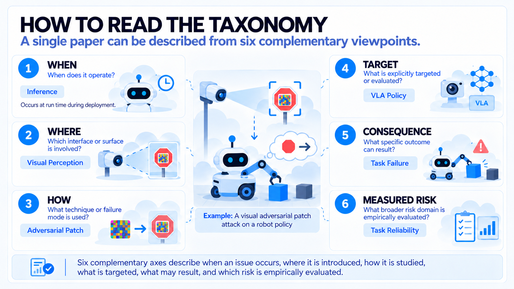
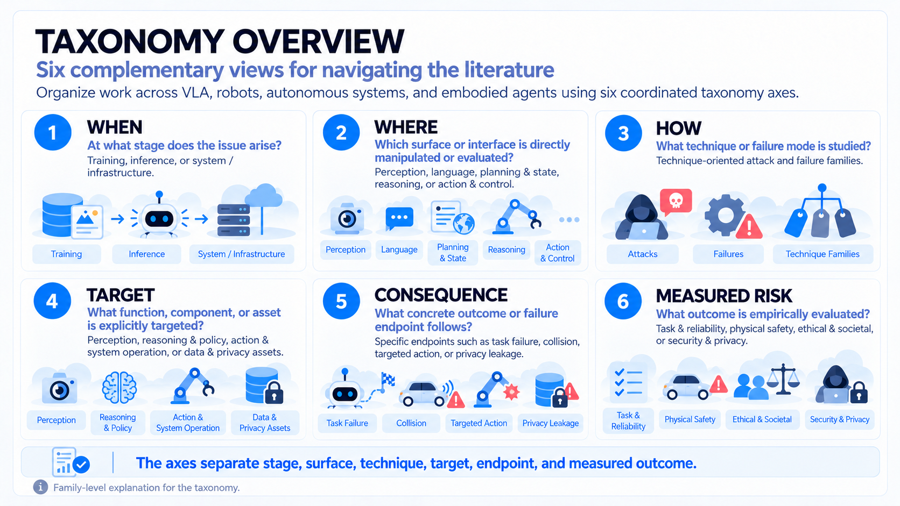
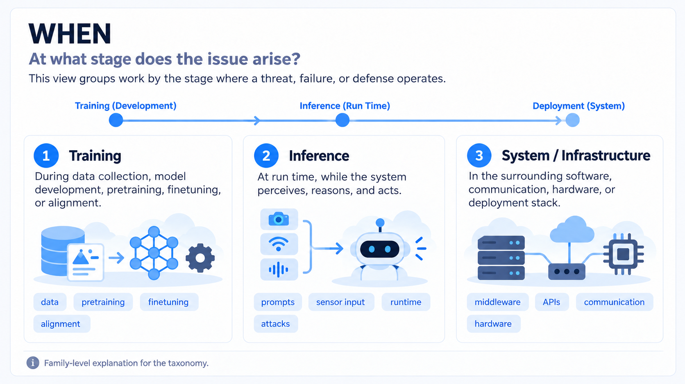
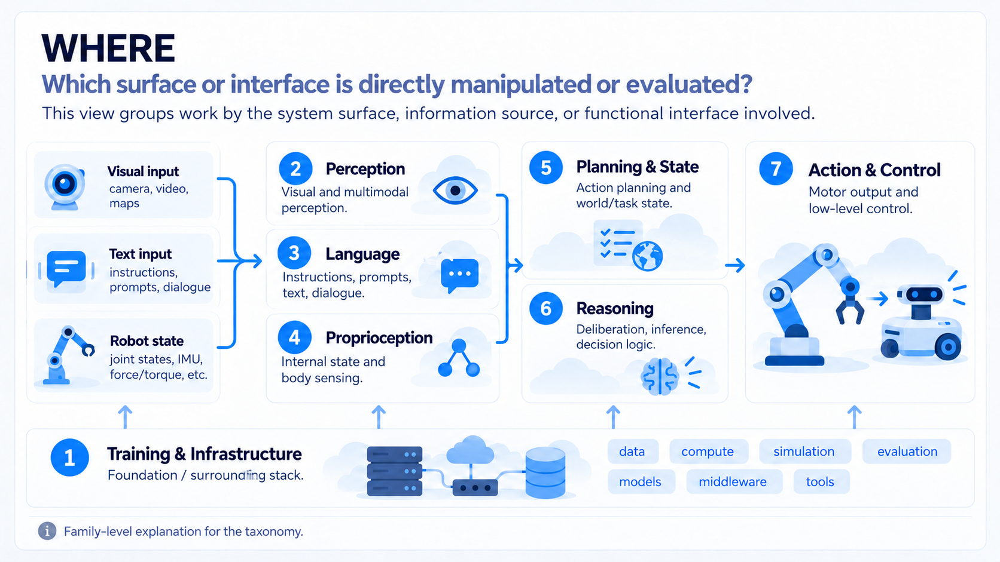
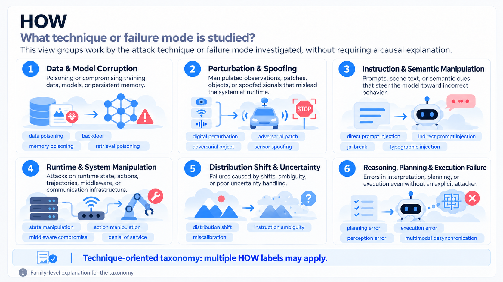
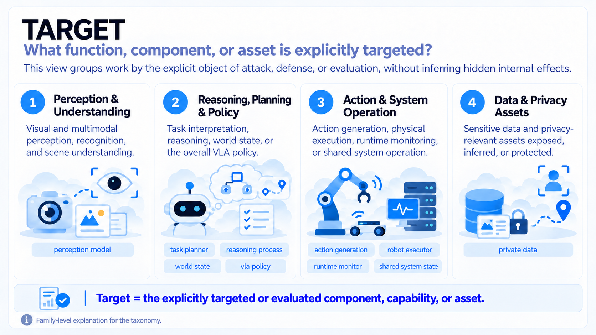
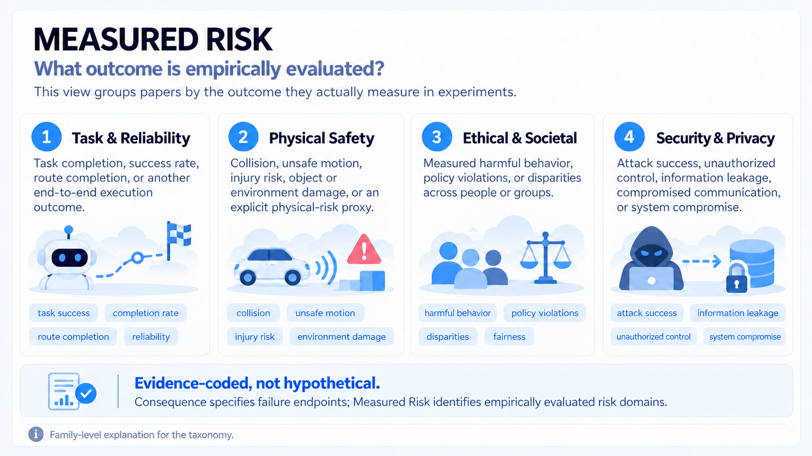

# Physical AI Safety Taxonomy

This catalog's original six-axis taxonomy was designed by [Futa Waseda](https://futa-waseda.netlify.app/) and refined through ongoing literature review. Suggestions for taxonomy improvements are welcome—please open a [GitHub issue](https://github.com/futakw/Awesome-Physical-AI-Safety/issues/new).

## How to Read the Taxonomy

  

Each paper in this catalog is described using six complementary taxonomy axes. The example above shows how a single paper can be mapped across all six views.

| Axis | Main question |
|---|---|
| **WHEN** | When does it occur? |
| **WHERE** | Where is the threat introduced or evaluated? |
| **HOW** | What technique or failure mode is studied? |
| **TARGET** | What is the target of attack or evaluation? |
| **CONSEQUENCE** | What happens as a result? |
| **MEASURED RISK** | What risk is empirically evaluated? |

## Overview

  

## WHEN

WHEN identifies the stage at which a threat is introduced or activated, or a failure is evaluated. A study can span more than one stage—for example, a backdoor may be implanted during training and activated at inference time.

  

<!-- taxonomy-sync:start lifecycle -->
| Label | Meaning |
|---|---|
| `training` | Data collection, pretraining, fine-tuning, post-training, model merging, or checkpoint distribution. |
| `inference` | Deployment-time perception, reasoning, planning, action generation, or interaction. |
| `system` | Middleware, networking, external services, multi-agent communication, or execution infrastructure. |
<!-- taxonomy-sync:end lifecycle -->

## WHERE

WHERE describes the surface that is directly manipulated, shifted, corrupted, or evaluated—not every internal component that might be affected later.

  

<!-- taxonomy-sync:start surface -->
| Family | Labels |
|---|---|
| **Training & Infrastructure** | `model-supply-chain`, `middleware-network` |
| **Perception** | `visual-perception`, `audio-perception`, `physical-semantic-environment` |
| **Language** | `user-instruction`, `context-memory-retrieval`, `multi-agent-communication` |
| **Proprioception** | `proprioception` |
| **Planning & State** | `world-state`, `task-planning` |
| **Reasoning** | `reasoning-representation` |
| **Action & Control** | `action-interface`, `execution-control` |
<!-- taxonomy-sync:end surface -->

For example, a printed instruction in a camera view may use the `physical-semantic-environment` surface, while a poisoned retrieval document uses `context-memory-retrieval`.

## HOW

HOW names the concrete attack technique or failure mode studied by the paper. It is technique-oriented: it describes what the study does or evaluates without claiming that the label is the deepest internal cause.

  

<!-- taxonomy-sync:start mechanism -->
| Family | Labels |
|---|---|
| **Data & Model Attacks** | `data-poisoning`, `backdoor`, `malicious-adapter`, `checkpoint-compromise`, `reward-manipulation`, `memory-poisoning`, `retrieval-poisoning`, `membership-inference` |
| **Perturbation & Spoofing** | `digital-perturbation`, `adversarial-patch`, `adversarial-object`, `sensor-spoofing`, `feedback-spoofing`, `environment-manipulation` |
| **Instruction & Semantic Manipulation** | `direct-prompt-injection`, `indirect-prompt-injection`, `jailbreak`, `typographic-injection`, `hazardous-instruction` |
| **Runtime & System Manipulation** | `middleware-compromise`, `network-attack`, `denial-of-service`, `covert-channel`, `state-manipulation`, `action-manipulation`, `trajectory-manipulation`, `representation-manipulation` |
| **Distribution Shift & Uncertainty** | `distribution-shift`, `instruction-ambiguity`, `uncertainty-miscalibration` |
| **Reasoning, Planning & Execution Failure** | `perception-error`, `semantic-misalignment`, `planning-error`, `execution-error`, `multimodal-desynchronization` |
<!-- taxonomy-sync:end mechanism -->

Data & Model Attacks includes poisoning or compromising data and models, as well as inferring sensitive information from them. Membership inference does not require data or model modification.

## TARGET

TARGET identifies the component, capability, or asset that the study explicitly attacks, protects, or evaluates. It does not assert knowledge of the system's hidden causal pathway.

  

<!-- taxonomy-sync:start target -->
| Family | Labels |
|---|---|
| **Perception & Understanding** | `perception-model` |
| **Reasoning, Planning & Policy** | `task-planner`, `reasoning-process`, `world-state`, `vla-policy` |
| **Action & System Operation** | `action-generation`, `robot-executor`, `runtime-monitor`, `shared-system-state` |
| **Data & Privacy Assets** | `private-data` |
<!-- taxonomy-sync:end target -->

An image-based attack does not automatically target a `perception-model`. If the paper evaluates only the end-to-end policy behavior, `vla-policy` may be the appropriate target.

## CONSEQUENCE

CONSEQUENCE records the specific outcome reached by the threat or failure path. It is a flat vocabulary of 12 labels; the labels are not divided into families.

<!-- taxonomy-sync:start consequence -->
| Label | Outcome |
|---|---|
| `task-failure` | The assigned task or route is not completed. |
| `recovery-failure` | Detection, mitigation, replanning, or recovery does not restore safe operation. |
| `collision` | The robot contacts an obstacle, person, or prohibited object. |
| `unsafe-motion` | Unsafe force, speed, pose, trajectory, or control behavior occurs. |
| `physical-damage` | A person, robot, object, or environment is harmed or damaged. |
| `targeted-action` | The system performs an attacker-selected action or action sequence. |
| `action-freezing` | The policy stops or produces dangerous inaction. |
| `control-hijacking` | An unauthorized source gains influence over robot behavior. |
| `unsafe-success` | The task succeeds while violating a safety property. |
| `policy-violation` | The agent performs explicitly prohibited or harmful behavior. |
| `privacy-leakage` | Sensitive information is inferred, exposed, or transmitted. |
| `availability-loss` | The system is frozen, stopped, delayed, or denied service. |
<!-- taxonomy-sync:end consequence -->

## MEASURED RISK

MEASURED RISK captures the broad risk domain that a paper evaluates empirically. A label is used only when experiments report a corresponding metric—not merely because the paper discusses a possible risk.

  

<!-- taxonomy-sync:start risks -->
| Category | Typical evidence |
|---|---|
| **Task & Reliability** (`task-reliability`) | Task success, route completion, or an equivalent end-to-end outcome. |
| **Physical Safety** (`physical-safety`) | Collision, damage, unsafe force or motion, or an explicit physical-risk proxy. |
| **Ethical & Societal** (`ethical-societal`) | Measured harmful behavior, policy violations, refusals, or disparities across people or groups. |
| **Security & Privacy** (`security-privacy`) | Attack success, unauthorized control, information leakage, or system compromise. |
<!-- taxonomy-sync:end risks -->

## Important Distinctions

| Axis | Keep in mind |
|---|---|
| **WHERE** | The manipulated or evaluated surface—the delivery channel or system boundary. |
| **HOW** | The studied attack technique or failure mode; it is not necessarily a root-cause explanation. |
| **TARGET** | What the study explicitly attacks, protects, or evaluates; it does not imply knowledge of internal causal mechanisms. |
| **CONSEQUENCE** | The specific result. This is a flat 12-label vocabulary with no families. |
| **MEASURED RISK** | One or more of four broad risk domains supported by reported metrics. |

## Illustrative Example

The following is illustrative, not a complete annotation of a particular paper. Consider a visible adversarial patch shown to a deployed VLA, evaluated by whether it makes the robot fail its task:

| Axis | Example label |
|---|---|
| WHEN | `inference` |
| WHERE | `visual-perception` |
| HOW | `adversarial-patch` |
| TARGET | `vla-policy` |
| CONSEQUENCE | `task-failure` |
| MEASURED RISK | `task-reliability`, and `security-privacy` if attack success is also reported |

For controlled definitions, boundary cases, and annotation policies, see the [Detailed Taxonomy & Annotation Guidelines](../reference/taxonomy.md).
