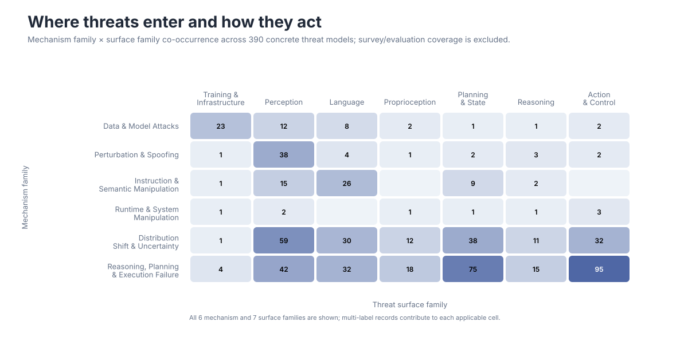
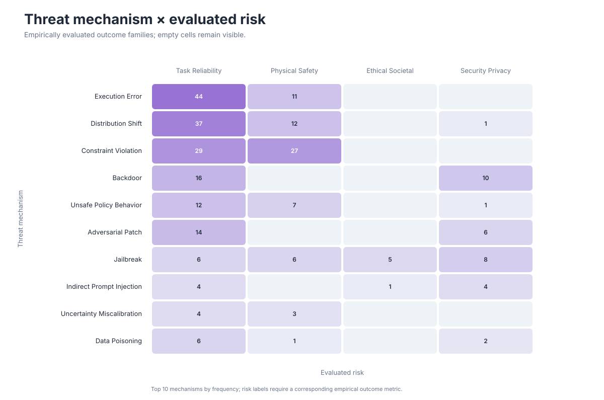
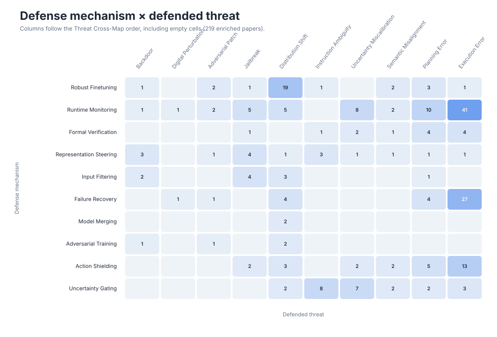

# Research Landscape

These views are generated from the structured metadata in [`data/papers.json`](../../data/papers.json). They describe the current catalog rather than the full publication volume of the field.

For hoverable paper lists, open the [interactive explorer](../index.html#heatmap). Each README preview links directly to its corresponding view.

## Search and Leaf Filters

The interactive data views share one filter state. Keyword search covers paper titles, first-author display names, venues, years, sections, subsections, scopes, tags, and the English, Japanese, and canonical forms of taxonomy leaf labels. Search terms separated by spaces are combined with AND.

Leaf filters cover all six taxonomy axes: WHEN (`lifecycle`), WHERE (`surface`), HOW (`mechanism`), TARGET (`target`), CONSEQUENCE (`consequence`), and MEASURED RISK (`risks`). Multiple selected leaves within one axis use OR; selections across different axes use AND. Keyword and leaf conditions are also combined with AND. For `survey` and `evaluation` records, supported coverage fields participate in filtering; unsupported axes, such as TARGET coverage, remain empty rather than being inferred.

Filters update both chart counts and the paper table. Clicking a chart cell applies an additional temporary table-only selection; resetting that selection returns to the globally filtered view.

## Counting and Coverage in the Interactive Views

Each cell counts distinct papers once, even when multiple leaf labels match the same family. Multi-label papers may contribute to multiple cells, so cell, row, and column sums are not unique-paper totals or percentages. These are paper-level co-occurrences, not causal relationships or necessarily pairs established in the same experiment.

- **Mechanism × Surface / Target × Consequence:** concrete threat-model records only; exclude `survey` and `evaluation` coverage records.
- **Mechanism × Measured Risk / Consequence × Measured Risk:** exclude `survey`, include `evaluation` coverage via `coverage.mechanisms` / `coverage.consequences`. Risk labels still require reported empirical metrics.
- **Defense × Threat:** all records with `defense` metadata, regardless of primary section; use `defense.mechanism` and `defense.defends_against`.

The displayed eligible count includes records with empty axis annotations; these records contribute to no cell unless both axis conditions match. An empty annotation does not establish absence of a risk. Empty cells mean zero matching catalog records, not proof of an unstudied topic. Catalog selection and annotation affect counts; counts do not measure field-wide prevalence or defense effectiveness. Each interactive view displays its current eligible and excluded counts.

## Field Timeline


Bubble area encodes the number of cataloged papers in each area-year cell.

## Submission Growth


The line uses verified initial submission dates, such as arXiv v1 dates. Unknown dates are excluded.

## Threat-Model Cross-Map



The heatmap includes concrete threat models and excludes broad survey/evaluation coverage. Multi-label papers contribute to every applicable mechanism-surface pair.

## Threat Mechanism × Measured Risk



Rows follow the same top threat-mechanism order as the Threat Cross-Map. Columns are the four evidence-coded `risks` outcomes; a paper contributes only when it reports a corresponding empirical metric.

## Defense Mechanism × Defended Threat



This view uses the optional `defense` extension across every primary section. It includes only substantive proposed or experimentally evaluated mitigations.

## Target × Consequence

This interactive-only cross-map connects the explicitly attacked, protected, or evaluated component, capability, or asset (TARGET) to a concrete outcome (CONSEQUENCE), without inferring downstream affected components. Open the [Project Page](../index.html#target) to inspect and filter its paper table.

Static benchmark and evaluation-extension heatmaps are also generated for metadata review. They are not currently top-level Project Page navigation views.

## Regeneration

```bash
python3 scripts/build_visualizations.py
python3 scripts/build_visualizations.py --check
python3 scripts/build_explorer.py
```
