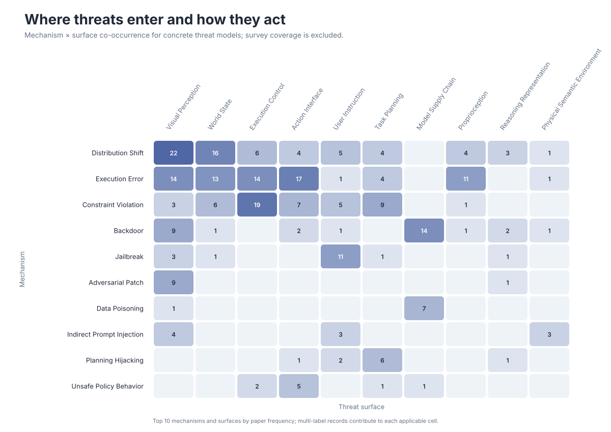
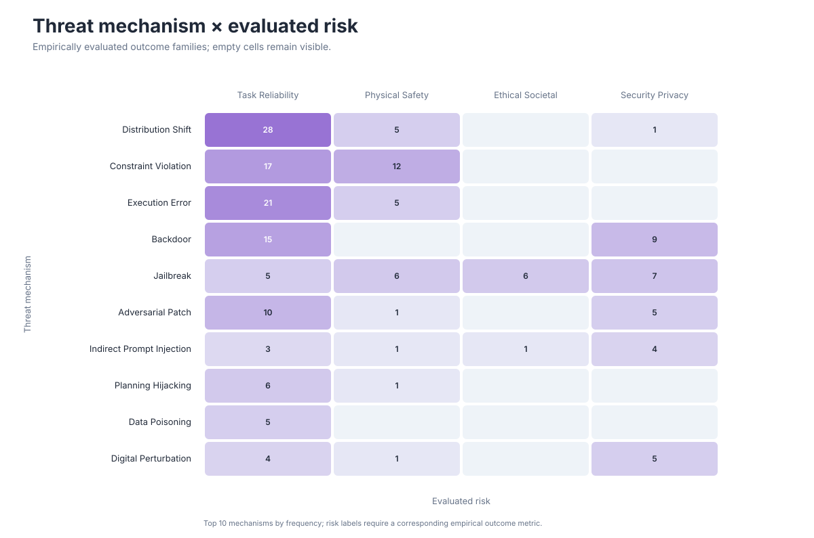

# Research Landscape

These views are generated from the structured metadata in [`data/papers.json`](../data/papers.json). They describe the current catalog rather than the full publication volume of the field.

For hoverable paper lists, open the [interactive explorer](index.html#heatmap). Each README preview links directly to its corresponding view.

## Field Timeline


Bubble area encodes the number of cataloged papers in each area-year cell.

## Threat-Model Cross-Map



The heatmap includes concrete threat models and excludes broad survey/evaluation coverage. Multi-label papers contribute to every applicable mechanism-surface pair.

## Threat Mechanism × Evaluated Risk



Rows follow the same top threat-mechanism order as the Threat Cross-Map. Columns are the four evidence-coded `risks` outcomes; a paper contributes only when it reports a corresponding empirical metric.

Defense, benchmark, and evaluation-extension cross-maps are not shown in the public Explorer while their catalog-derived classifications await paper-level verification.

## Regeneration

```bash
python3 scripts/build_visualizations.py
python3 scripts/build_visualizations.py --check
python3 scripts/build_explorer.py
```
