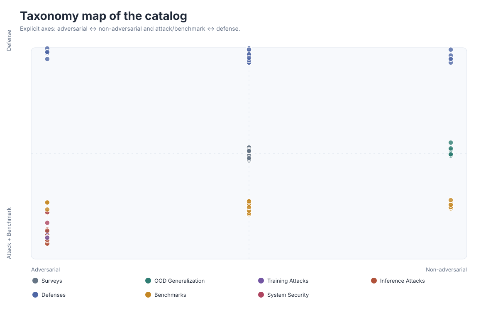
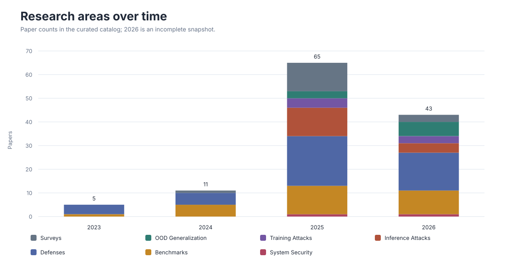

# Research Landscape

These views are generated from the structured metadata in [`data/papers.json`](../data/papers.json). They describe the current catalog rather than the full publication volume of the field.

For hoverable paper details and linked paper lists, open the [interactive explorer](index.html). GitHub README markdown cannot execute JavaScript, so the README keeps a static preview and links to this page.

## Taxonomy Map



The map uses explicit, interpretable axes. X is the threat kind (`adversarial` ↔ `non-adversarial`); Y is the catalog role (`attack + benchmark` ↔ `defense`). Survey and system-failure records sit near the center. It is a taxonomy view, not an abstract-semantic embedding.

## Topic Trends



The final year is an incomplete snapshot. Counts also reflect the repository's curation coverage.

## Field Timeline


Bubble area encodes the number of cataloged papers in each area-year cell.

## Threat-Model Cross-Map


The heatmap includes concrete threat models and excludes broad survey/evaluation coverage. Multi-label papers contribute to every applicable mechanism-surface pair.

## Regeneration

```bash
python3 scripts/build_visualizations.py
python3 scripts/build_visualizations.py --check
python3 scripts/build_explorer.py
```
