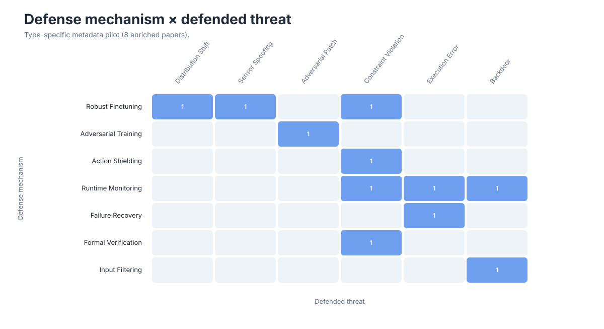
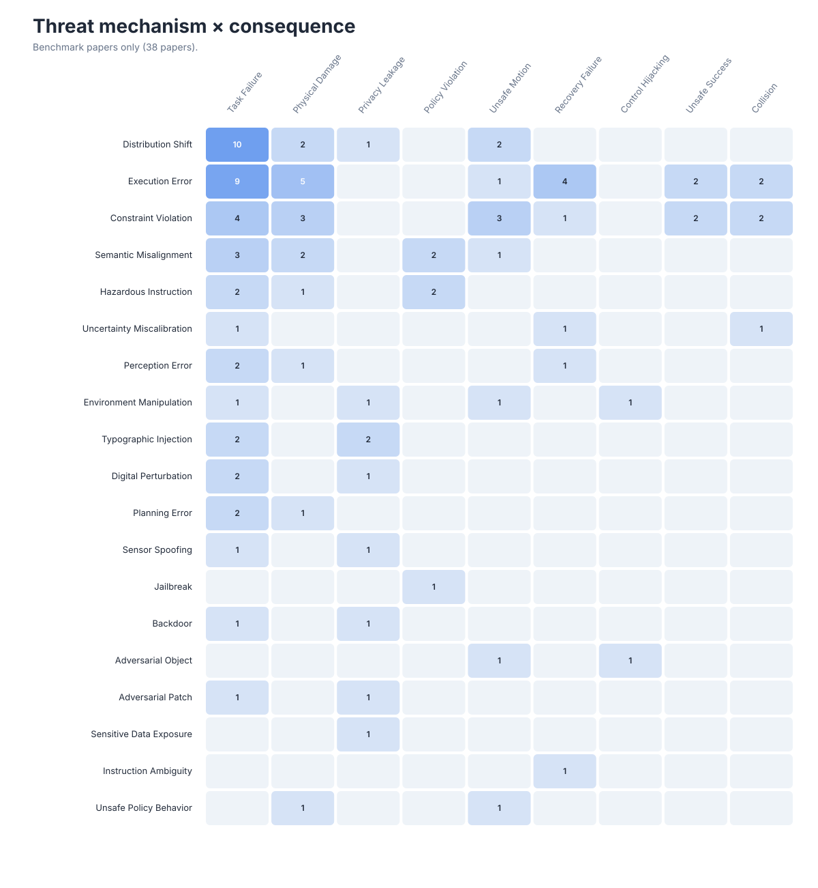

# Research Landscape

These views are generated from the structured metadata in [`data/papers.json`](../data/papers.json). They describe the current catalog rather than the full publication volume of the field.

For hoverable paper lists, open the [interactive explorer](index.html). GitHub README markdown cannot execute JavaScript, so the README keeps a static preview and links to this page.

## Field Timeline


Bubble area encodes the number of cataloged papers in each area-year cell.

## Threat-Model Cross-Map


The heatmap includes concrete threat models and excludes broad survey/evaluation coverage. Multi-label papers contribute to every applicable mechanism-surface pair.

## Defense Cross-Map



Rows are defense subsections; columns use the same top-10 `threat_model.mechanism` order as the Threat-Model Cross-Map, including zero-count cells. The interactive explorer supports hover and click-to-pin paper lists.

## Benchmark Cross-Map



Rows are benchmark subsections; columns use the same threat-mechanism order as the other cross-maps, including zero-count cells.

## Regeneration

```bash
python3 scripts/build_visualizations.py
python3 scripts/build_visualizations.py --check
python3 scripts/build_explorer.py
```
