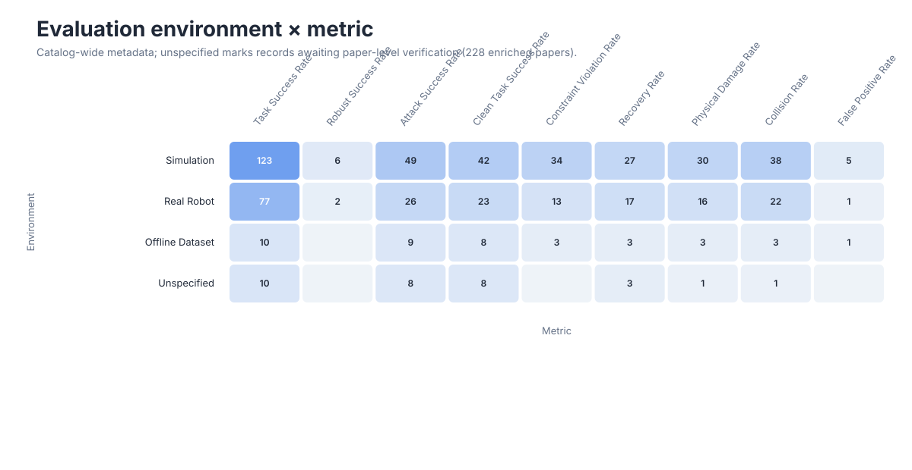

# Research Landscape

These views are generated from the structured metadata in [`data/papers.json`](../data/papers.json). They describe the current catalog rather than the full publication volume of the field.

For hoverable paper lists, open the [interactive explorer](index.html). GitHub README markdown cannot execute JavaScript, so the README keeps a static preview and links to this page.

## Field Timeline


Bubble area encodes the number of cataloged papers in each area-year cell.

## Threat-Model Cross-Map


The heatmap includes concrete threat models and excludes broad survey/evaluation coverage. Multi-label papers contribute to every applicable mechanism-surface pair.

## Defense Cross-Map


Rows are `defense.mechanism` values and columns are `defense.defends_against` values. Only records enriched with the optional Defense extension are counted.

## Benchmark Cross-Map


Rows are `benchmark.evaluates` values and columns are `benchmark.shift_types` values. Only records enriched with the optional Benchmark extension are counted.

## Evaluation Cross-Map



Rows are `evaluation.environments` values and columns are `evaluation.metrics` values. Only records enriched with the optional Evaluation extension are counted.

## Regeneration

```bash
python3 scripts/build_visualizations.py
python3 scripts/build_visualizations.py --check
python3 scripts/build_explorer.py
```
